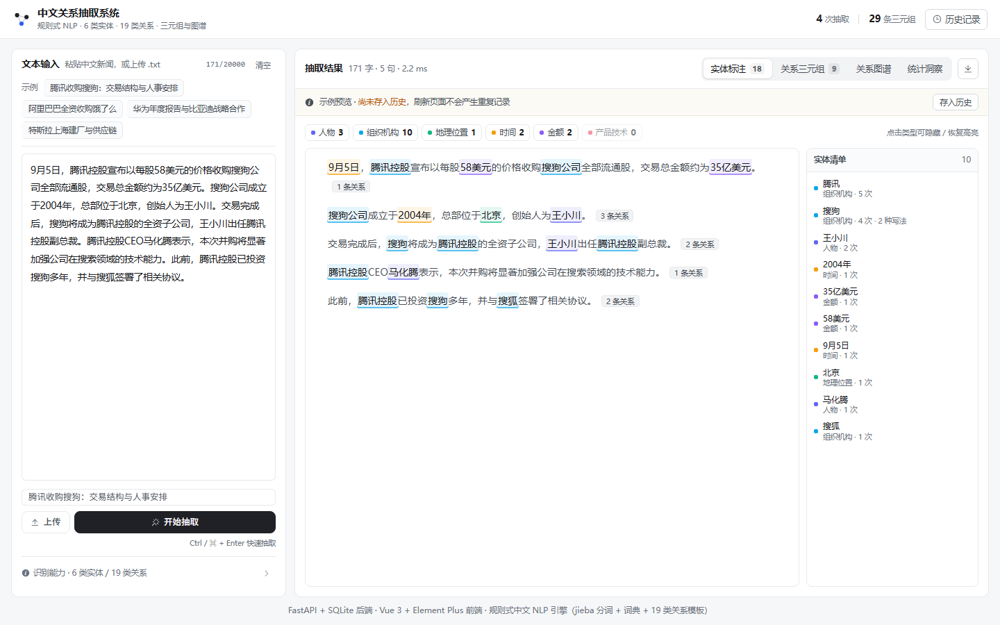
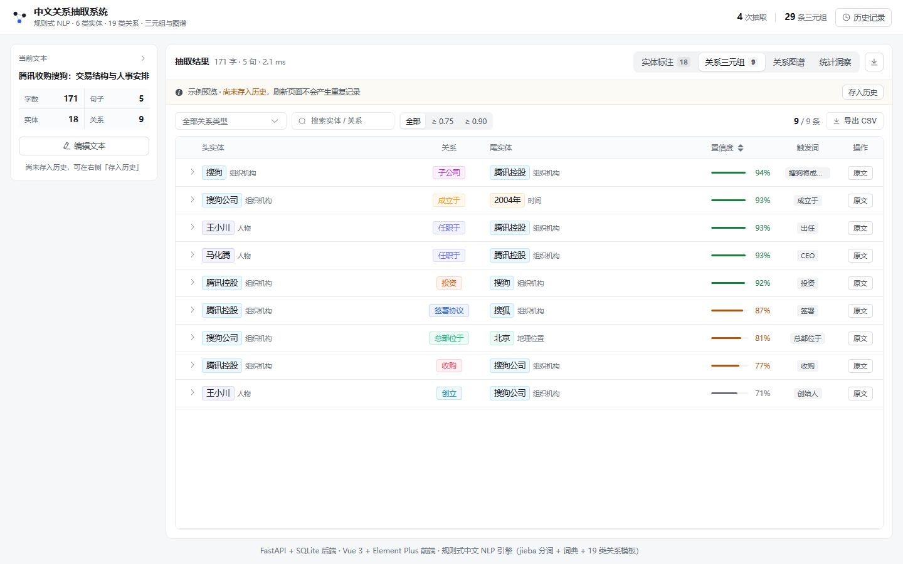
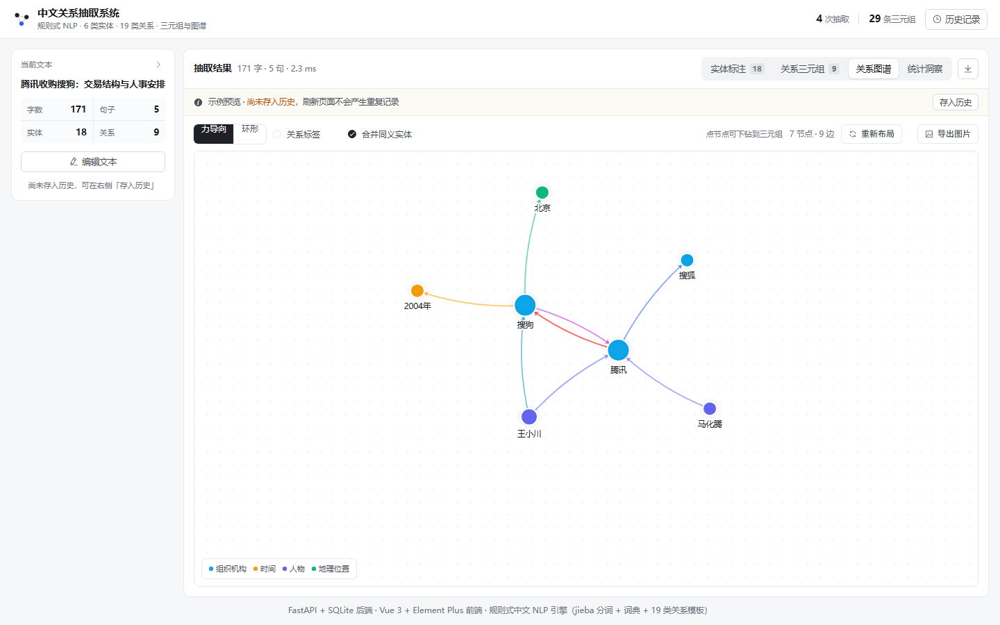
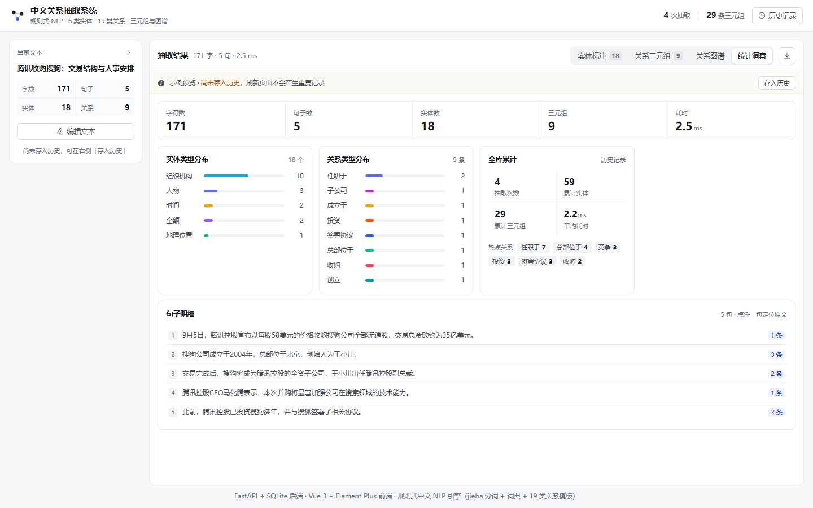
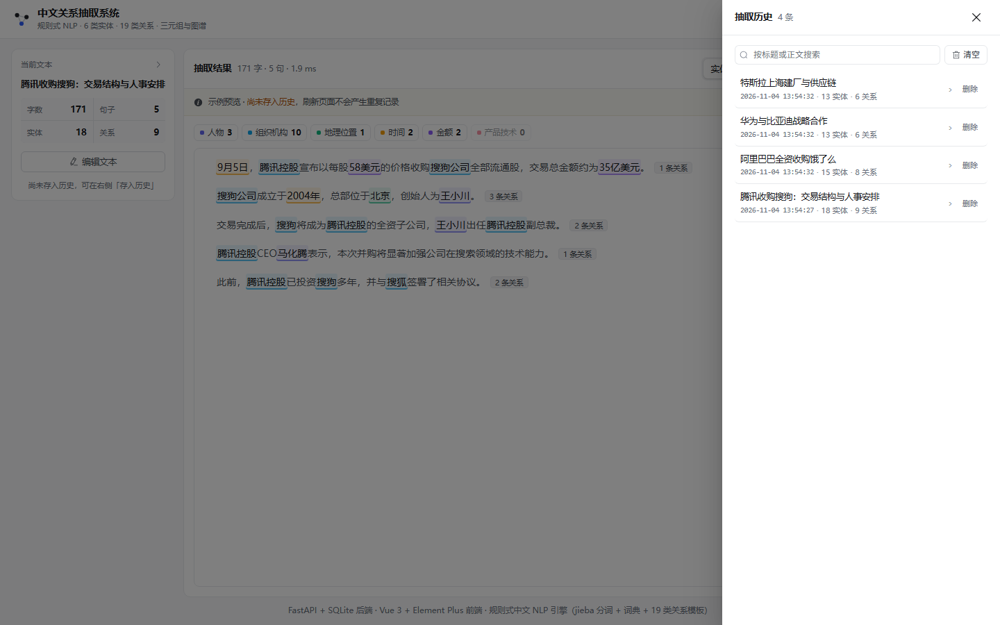

# 中文关系抽取系统（Chinese Relation Extraction System）

> 软件工程课程作业 · 基于自然语言处理的中文实体识别与关系抽取可视化系统
>
> 前端 **Vue 3 + Element Plus** ｜ 后端 **FastAPI + SQLite** ｜ NLP 引擎 **jieba + 词典 + 规则模板**（离线、确定性、可解释）

用户粘贴一段中文新闻（或上传 `.txt` 文件），系统自动完成**分句 → 分词 → 实体识别 → 关系抽取 → 三元组输出 → 图谱可视化**，并以「实体高亮标注 / 三元组表格 / 节点-关系图 / 统计洞察」四种形式呈现，历史结果持久化到 SQLite。



---

## 一、功能一览

| 需求 | 实现 |
| --- | --- |
| **文本输入** | 支持粘贴长文本（≤ 20000 字），或上传 `.txt / .md / .text` 文件（≤ 2MB）；文件编码自动识别 UTF-8 / GB18030 / GBK / UTF-16 / BIG5，无需手工转码 |
| **实体识别** | 识别人物、组织机构、地理位置、时间、金额、产品技术共 **6 类实体**，正文中彩色高亮 + hover 显示类型与置信度 + 侧栏实体清单，可按类型显隐 |
| **关系抽取** | 输出 `<头实体, 关系, 尾实体>` 三元组，覆盖收购、投资、任职于、总部位于、创立、合作、签署协议等 **19 类关系**，每条结果附带置信度、触发词、证据句与所用规则；内置**轻量指代消解**（"该工厂 / 双方 / 后者"自动回指到真实实体）与**主语链继承**（"……并与 B 签署……"继承上一分句主语），并在三元组表格中标注"指代消解 / 主语链"规则来源 |
| **实体归一** | 机构名递归剥离"有限公司 / 集团 / 控股"等后缀（腾讯控股有限公司 → 腾讯），同一实体的多种写法在图谱、清单与统计中合并为一个节点，清单上以角标提示已合并 |
| **结果可视化** | ① 三元组表格（按关系类型/置信度过滤、关键词搜索、展开行查看完整证据句）② ECharts 力导向/环形关系图（可拖拽、缩放、合并同义实体）③ 统计洞察（实体/关系分布、句级关系数、全库累计） |
| **结果导出** | 右上角统一导出菜单：三元组 **CSV**（带 BOM，Excel 打开不乱码，表头含规范化名，可导入 Neo4j）、完整 **JSON**、**Markdown** 分析报告（含统计表 / 实体表 / 证据句 / 原文）、关系图谱 **PNG** |
| **历史记录** | 页面初始化时的示例抽取仅作预览、**不写库**（避免刷新产生重复记录）；主动抽取或点击「存入历史」才入库，支持按标题/正文检索、分页、载入复现、单条删除与一键清空 |
| **效果评测** | `eval/` 下提供 10 段人工标注金标准集与 P/R/F1 评测脚本，输出整体与分类型指标及漏抽/误抽明细 |
| **交互体验** | 内置 4 条中文新闻示例（一键切换并自动抽取）、空状态引导、字数计数、错误提示、响应式布局（≤1120px 单列）；结果与证据双向联动（表格→原文定位、图谱→三元组下钻、统计→原文定位）；结果就绪后左栏自动收窄为摘要卡，正文阅读宽度 +40% |

### 界面截图

| 关系三元组 | 关系图谱 |
| --- | --- |
|  |  |

| 统计洞察 | 历史记录 |
| --- | --- |
|  |  |

两个交互设计点（截图里是静态的，实际是联动的）：

- **证据链穿透**：三元组行的「原文」按钮 → 跳到实体标注视图并高亮该证据句；图谱节点 → 切到三元组并带上「实体：腾讯 ✕」筛选；统计页句子行 → 定位到原文。目的是把「这条关系凭什么抽出来」的核对成本压到一次点击。
- **输入 / 结果自适应配比**：抽取完成后左栏从 396px 收窄为 236px 摘要卡（标题 + 字数/句/实体/关系），阅读区宽度增加约 40%，`Ctrl/⌘ + E` 随时展开；≤1120px 自动禁用，保持单列布局。

---

## 二、技术栈

| 层次 | 选型 | 说明 |
| --- | --- | --- |
| 前端框架 | Vue 3（`<script setup>` 组合式 API） | 组件化拆分工作台 / 标注 / 表格 / 图谱 / 统计 / 历史抽屉 |
| UI 组件库 | Element Plus 2.8（中文 locale） | 输入、表格、抽屉、分页、消息提示等 |
| 可视化 | ECharts 5（graph 关系图） | 力导向与环形两种布局，支持拖拽与导出 |
| HTTP | Axios | 统一拦截后端 `detail` 错误信息 |
| 构建 | Vite 5 | 开发代理 `/api` → `127.0.0.1:8000`，产物 `dist/` |
| 后端框架 | FastAPI（Pydantic v2 校验） | 自动生成 OpenAPI 文档 `/docs` |
| 服务器 | Uvicorn | 单进程即可同时托管 API 与前端静态资源 |
| 数据库 | SQLite（标准库 `sqlite3`） | 零配置，`backend/data/app.db` 单文件持久化 |
| NLP | jieba 0.42 + 自建词典 + 正则规则 | 纯规则流水线，无需下载模型，毫秒级响应 |

---

## 三、目录结构

```
软件工程作业（修改框架版）/
├─ backend/
│  ├─ app/
│  │  ├─ main.py              # FastAPI 应用入口（含 SPA 静态托管）
│  │  ├─ db.py                # SQLite 建表与 records/relations 读写
│  │  ├─ samples.py           # 4 条内置中文新闻示例
│  │  ├─ nlp/
│  │  │  ├─ lexicon.py        # 实体词典、19 类关系规则、句式模板、实体类型目录
│  │  │  ├─ tokenizer.py      # 分句 + jieba 分词（注入自定义词典）
│  │  │  ├─ entity.py         # 实体识别（词典/后缀/上下文/词性 四通道 + 重叠消解）
│  │  │  ├─ relation.py       # 关系抽取（指代消解、句式模板、触发词容错、去重与置信度）
│  │  │  └─ pipeline.py       # analyze(text) 统一流水线出口
│  │  └─ routers/
│  │     ├─ extract.py        # /api/extract、/api/extract/file、/api/health
│  │     └─ meta.py           # /api/records、/api/stats、/api/samples、/api/schema
│  ├─ data/app.db             # SQLite 数据文件（首次运行自动创建，WAL 模式）
│  ├─ devtools/check.py       # 离线自检脚本：对内置示例跑抽取并打印结果
│  ├─ eval/
│  │  ├─ gold.json            # 10 段人工标注金标准集（48 条三元组，14 类关系）
│  │  ├─ run_eval.py          # P/R/F1 评测脚本（--json 可机读输出）
│  │  └─ REPORT.md            # 评测报告：指标、分类型结果、错误分析
│  └─ requirements.txt
├─ frontend/
│  ├─ src/
│  │  ├─ App.vue              # 顶栏 + 双栏布局 + 四个结果页签 + 历史抽屉
│  │  ├─ main.js / styles.css # Element Plus 注册、全局设计系统
│  │  ├─ api/client.js        # Axios 封装（抽取/记录/统计/示例/元数据）
│  │  ├─ utils/export.js      # 导出构建：CSV / JSON / Markdown + 文件名清洗
│  │  └─ components/
│  │     ├─ TextWorkbench.vue   # 文本输入、示例、上传、清空、识别能力面板
│  │     ├─ EntityAnnotator.vue # 正文实体高亮 + 类型筛选 + 实体清单
│  │     ├─ TripleTable.vue     # 三元组表格（过滤/搜索/排序/导出 CSV）
│  │     ├─ RelationGraph.vue   # ECharts 关系图（布局切换/标签/合并/导出）
│  │     ├─ StatsOverview.vue   # 指标卡、类型分布、句级统计、全库累计
│  │     └─ HistoryDrawer.vue   # 历史记录抽屉（检索/载入/删除/清空）
│  ├─ index.html / vite.config.js / package.json
├─ docs/screenshots/          # 界面截图
└─ README.md
```

---

## 四、快速开始

### 1. 环境要求

- Python **3.10+**（开发与验证环境：3.11.9）
- Node.js **18+**（开发与验证环境：v24.17.0）、npm

### 2. 启动后端

```bash
cd backend
python -m pip install -r requirements.txt
python main.py                # 一键启动（推荐），访问 http://127.0.0.1:8000
# 可选参数：python main.py --port 9000 ｜ python main.py --reload（开发热更新）
# 等价旧方式：python -m uvicorn app.main:app --reload --port 8000
```

- 接口文档：<http://127.0.0.1:8000/docs>
- 健康检查：<http://127.0.0.1:8000/api/health>

### 3A. 前端开发模式（热更新）

```bash
cd frontend
npm install
npm run dev
```

打开 <http://localhost:5173>（Vite 默认绑定 `localhost`，若用 `127.0.0.1` 无法访问请改用 `localhost`），Vite 会把 `/api` 代理到 `127.0.0.1:8000`。

### 3B. 生产模式（单端口，推荐用于演示）

```bash
cd frontend
npm install
npm run build          # 产物输出到 frontend/dist
cd ../backend
python -m uvicorn app.main:app --port 8000
```

后端检测到 `frontend/dist` 后会自动托管静态资源，**直接访问 <http://127.0.0.1:8000> 即可**（无需另起前端服务）。

### 4. 离线自检（无需启动服务）

```bash
cd backend
python devtools/check.py
```

脚本会对 4 条内置示例执行抽取，打印实体数与三元组明细，用于回归验证 NLP 模块。

### 5. 效果评测

```bash
cd backend
python eval/run_eval.py            # 表格报告 + 漏抽/误抽明细
python eval/run_eval.py --json     # 机读格式，便于接入 CI
```

在 `eval/gold.json` 的 10 段人工标注文本（1 283 字 / 48 条三元组 / 14 类关系）上计算 Precision / Recall / F1。当前 **P 0.936 · R 0.917 · F1 0.926**（Macro-F1 0.937），完整的分类型指标与错误分析见 [`backend/eval/REPORT.md`](backend/eval/REPORT.md)。

---

## 五、NLP 实现原理

### 5.1 流水线

```
原始文本
  │ ① 分句：按 。！？；!? 与换行切分并保留字符偏移，合并过短碎片
  │ ② 分词：jieba.posseg 词性标注；启动时把词典中的机构/人名/地名/产品全部注入用户词典
  │ ③ 实体识别：四条通道并行产出候选，再统一消解
  │      · 词典精确匹配（机构、地名、人名、产品名录）
  │      · 后缀构词（"…有限公司 / …大学 / …研究院"；"…省 / …市 / …区"；
  │        机构名不从地名上扩展，避免"德国默克集团"被粘成"德国默克集团"）
  │      · 上下文正则（"CEO 张勇"、"张勇表示"、"由 王小川"）
  │      · 词性规则（nr/nrfg → 人物，ns → 地名，nt → 机构，nz → 产品）
  │     → 同位置去重、按长度与来源优先级消解重叠、过滤泛称（"子公司/该集团"）
  │ ④ 指代消解（DocumentContext，跨句维护）：
  │      · "该工厂/该公司" —— 依据 "投资建设了 XX 工厂" 的归属登记回指到主体
  │      · "双方/两者" —— 句内最近的两个机构，不足时回溯全文最近两机构
  │      · "后者/前者" —— 句内最近一组并列实体（"A 与 B"）中对应的一方
  │     → 指代词生成"伪实体"参与匹配，落地后替换为真实实体，不进入输出
  │ ⑤ 关系抽取：句内执行
  │      · 句式模板优先（如「{0}成为{1}的全资子公司」「{1}的CEO是{0}」）置信度 0.96
  │      · 触发词扫描兜底（收购 / 投资 / 出任 / 总部位于 …）按距离取最近且类型兼容的实体对
  │      · 主语链：分句以"并/且/也"开头时头实体继承上一分句主语
  │      · 隐性竞争："挤压/蚕食/抢占…市场份额"主语取全文话题实体
  │      · 被动（"被…收购"）、并列（"华为与比亚迪签署"）、后置定语（"总部位于杭州的A公司"）
  │ ⑥ 归一化与去重：(头, 关系, 尾) 取最高分、去除自环、按置信度排序、
  │    机构名去后缀生成 canonical；"总部位于" 覆盖泛化的 "位于"，
  │    "签署协议" 覆盖同向的 "供应"（供货协议类名词短语不再当作供应事件）
  ▼
{ entities, relations, entity_type_counts, relation_type_counts, stats }
```

### 5.2 实体类型

| key | 类型 | 颜色 | 识别依据 |
| --- | --- | --- | --- |
| `PERSON` | 人物 | 靛蓝 | 姓氏表（406 个姓氏 + 复姓）、职位上下文、言说动词、jieba `nr` |
| `ORG` | 组织机构 | 天蓝 | 机构后缀构词、机构名录、jieba `nt`、英文公司后缀（Inc/Corp/Group/Ltd） |
| `LOC` | 地理位置 | 青绿 | 行政区划后缀（省/市/区/县/州）、地名词典、jieba `ns` |
| `TIME` | 时间 | 琥珀 | `\d{4}年`、`\d{1,2}月\d{1,2}日`、"今年以来"等 |
| `MONEY` | 金额 | 紫 | 数字 + 亿美元/亿元/万元/元（排除"20 万名员工"等量词误判） |
| `PRODUCT` | 产品技术 | 玫红 | 产品词典、英文专名、jieba `nz` |

### 5.3 关系类型（19 类）

| key | 关系 | 头 → 尾 类型约束 | 说明 / 触发词示例 |
| --- | --- | --- | --- |
| `acquire` | 收购 | ORG → ORG | 一方取得另一方控制权（收购 / 并购 / 全资收购） |
| `invest` | 投资 | ORG/PERSON → ORG/LOC | 资金换取股权或向某地投资（投资 / 注资 / 建厂） |
| `control` | 控股 | ORG/PERSON → ORG | 持有对方多数股权（控股 / 持股） |
| `subsidiary` | 子公司 | ORG → ORG | 隶属与控股关系（全资子公司 / 成为…的子公司） |
| `employ` | 任职于 | PERSON → ORG | 人物在某组织任职（出任 / 担任 / CEO / 总裁） |
| `appoint` | 任命 | ORG → PERSON | 组织对人物的职务任命（任命 / 委任） |
| `headquarter` | 总部位于 | ORG → LOC | 组织总部所在地（总部位于 / 总部设于） |
| `locate` | 位于 | ORG/LOC → LOC | 实体地理位置（位于 / 坐落于） |
| `found` | 创立 | PERSON → ORG | 人物创建组织（创立 / 创办 / 创始人） |
| `founded_at` | 成立于 | ORG → TIME | 组织成立时间（成立于 / 创建于） |
| `graduate` | 毕业于 | PERSON → ORG | 教育背景（毕业于 / 就读于） |
| `born` | 出生于 | PERSON → LOC | 人物出生地（出生于 / 生于） |
| `cooperate` | 合作 | ORG → ORG | 业务协作（合作 / 战略合作，对称关系） |
| `compete` | 竞争 | ORG → ORG | 市场竞争（竞争 / 对手，对称关系） |
| `supply` | 供应 | ORG → ORG/PRODUCT | 产业链上下游供应（供应 / 供货 / 配套） |
| `sign` | 签署协议 | ORG → ORG | 签署合作协议（签署 / 签订 / 达成协议） |
| `sue` | 诉讼 | ORG/PERSON → ORG/PERSON | 法律诉讼（起诉 / 诉讼 / 索赔） |
| `launch` | 发布 | ORG → PRODUCT | 产品或技术发布（发布 / 推出 / 上线） |
| `belong` | 隶属于 | ORG → ORG | 行政隶属（隶属于 / 隶属） |

### 5.4 置信度计算

```
句式模板命中：0.96
触发词命中：0.93 − min(0.32, 0.013 × 头尾实体距离)
指代消解命中：0.90 − 距离惩罚（"该工厂/双方/后者"回指的三元组）
主语链命中：0.93 − 距离惩罚 − 0.03
修正项：被动句 −0.06 ｜ 并列结构 −0.05 ｜ 后置定语 −0.04 ｜ "的+职位" −0.05
指代消解：群体关系 −0.04（组内配对 −0.02）｜ "后者"供应 −0.03 ｜ 并列宾语 −0.03
最终夹在 [0.52, 0.98] 区间
```

### 5.5 三个关键工程要点

1. **实体识别必须受分词边界约束。** 早期版本直接对整句套机构后缀正则，`[\u4e00-\u9fa5…]{1,13}公司` 会把「以每股 58 美元的价格收购搜狗公司」整体识别为机构，进而吞掉其余实体、使关系数归零。改为"以 jieba 切分出的 token 为单位向前扩展"后彻底解决。
2. **句内坐标与全文坐标必须统一。** 实体携带的是全文绝对偏移，而模板/触发词匹配在单句内进行，二者混用会导致"永远找不到实体"。抽取前统一换算为句内相对偏移。
3. **泛称与虚词必须过滤。** "全资子公司 / 该公司 / 董事会"等泛称若被当作实体，会抢占头尾位置；同时必须保证触发词不落在实体内部（否则"腾讯**控股**"会被误抽成「王小川 控股 搜狗」）。

---

## 六、接口文档

| 方法 | 路径 | 说明 |
| --- | --- | --- |
| `GET` | `/api/health` | 健康检查，返回引擎标识 |
| `POST` | `/api/extract` | 请求体 `{text, title, save}`，返回 `{record_id, result}` |
| `POST` | `/api/extract/file` | `multipart/form-data` 上传 `.txt/.md/.text`（≤2MB），自动识别编码 |
| `GET` | `/api/records` | 历史记录分页，参数 `limit / offset / keyword` |
| `GET` | `/api/records/{id}` | 单条记录详情（含实体与三元组） |
| `DELETE` | `/api/records/{id}` | 删除单条记录 |
| `DELETE` | `/api/records` | 清空全部记录 |
| `GET` | `/api/stats` | 全库统计：记录数、实体数、三元组数、平均耗时、热门关系、活跃实体 |
| `GET` | `/api/samples` | 内置示例新闻 |
| `GET` | `/api/schema` | 实体类型与关系类型目录（含颜色，供前端渲染） |

`result` 结构：

```json
{
  "text": "…原文…",
  "sentences": [{ "index": 0, "start": 0, "end": 37, "text": "…" }],
  "entities": [
    { "id": 1, "text": "腾讯控股", "type": "ORG", "start": 4, "end": 8,
      "confidence": 1.0, "source": "gazetteer", "canonical": "腾讯", "sentence_index": 0 }
  ],
  "relations": [
    { "head": "腾讯控股", "head_type": "ORG", "head_canonical": "腾讯",
      "relation": "acquire", "relation_label": "收购",
      "tail": "搜狗公司", "tail_type": "ORG", "tail_canonical": "搜狗",
      "confidence": 0.77, "evidence": "9月5日，腾讯控股宣布以每股58美元的价格收购搜狗公司…",
      "trigger": "收购", "rule_base": "trigger", "sentence_index": 0 }
  ],
  "entity_type_counts": { "ORG": 10, "PERSON": 3, "TIME": 2, "MONEY": 2, "LOC": 1 },
  "relation_type_counts": { "subsidiary": 1, "acquire": 1, "employ": 2 },
  "stats": { "char_count": 171, "sentence_count": 5, "entity_count": 18,
             "relation_count": 9, "elapsed_ms": 1.9 }
}
```

---

## 七、数据库设计

```sql
CREATE TABLE records (
    id             INTEGER PRIMARY KEY AUTOINCREMENT,
    title          TEXT    NOT NULL,
    text           TEXT    NOT NULL,
    source         TEXT    NOT NULL DEFAULT 'text',   -- text | file
    char_count     INTEGER, sentence_count INTEGER,
    entity_count   INTEGER, relation_count INTEGER,
    entity_types   TEXT,      -- JSON: {类型: 数量}
    entities_json  TEXT,      -- JSON: 实体数组
    elapsed_ms     REAL,
    created_at     TEXT       -- 本地时间 YYYY-MM-DD HH:MM:SS
);

CREATE TABLE relations (
    id INTEGER PRIMARY KEY AUTOINCREMENT,
    record_id      INTEGER NOT NULL REFERENCES records(id) ON DELETE CASCADE,
    head TEXT, head_canonical TEXT, head_type TEXT,
    relation TEXT, relation_label TEXT,
    tail TEXT, tail_canonical TEXT, tail_type TEXT,
    confidence REAL, evidence TEXT, trigger TEXT, sentence_index INTEGER
);
```

三元组单独建表（而非仅存 JSON），便于后续做聚合统计与关系检索；`records.entities_json` 保留完整实体信息供历史记录复现。

`head_canonical / tail_canonical` 存归一后的实体名，使"腾讯控股"与"腾讯"在统计聚合中落到同一条记录——否则全库排行榜会把同一实体拆成多行。旧库在启动时由 `db._migrate()` 自动补列并回填（幂等）。

连接层开启 `journal_mode=WAL` 与 `busy_timeout=5000`，避免一个写请求把整个库锁住导致并发请求报 `database is locked`。

---

## 八、效果示例

输入（内置示例《腾讯收购搜狗》）共 171 字、5 句，抽取结果 **18 个实体 / 9 条三元组**（耗时约 2 ms）：

| 头实体 | 关系 | 尾实体 | 置信度 | 触发词 |
| --- | --- | --- | --- | --- |
| 搜狗 | 子公司 | 腾讯控股 | 94% | 搜狗将成为腾讯控股的全资子公司 |
| 搜狗公司 | 成立于 | 2004 年 | 93% | 成立于 |
| 王小川 | 任职于 | 腾讯控股 | 93% | 出任 |
| 马化腾 | 任职于 | 腾讯控股 | 93% | CEO |
| 腾讯控股 | 签署协议 | 搜狐 | 93% | 签署 |
| 腾讯控股 | 投资 | 搜狗 | 92% | 投资 |
| 搜狗公司 | 总部位于 | 北京 | 81% | 总部位于 |
| 腾讯控股 | 收购 | 搜狗公司 | 77% | 收购 |
| 王小川 | 创立 | 搜狗公司 | 71% | 创始人 |

其余三条示例分别得到：阿里收购饿了么 **15 实体 / 8 关系**、华为与比亚迪 **13 实体 / 6 关系**、特斯拉上海建厂 **13 实体 / 7 关系**。

---

## 九、评测结果

在 10 段人工标注新闻（48 条三元组 / 14 类关系）上的表现：

| 指标 | 数值 |
| --- | --- |
| Precision | **0.936** |
| Recall | **0.917** |
| F1 | **0.926** |
| Macro-F1 | 0.937 |

P0 三项优化（指代消解、方向修正、触发词容错）的前后对比如下：

| 指标 | 优化前 | 优化后 |
| --- | --- | --- |
| Precision | 0.814 | **0.936** |
| Recall | 0.729 | **0.917** |
| F1 | 0.769 | **0.926** |
| Macro-F1 | 0.734 | **0.937** |

10 段中 7 段完全正确；竞争、签署协议、子公司三类关系的 F1 分别达到 1.00 / 0.91 / 1.00。剩余情况：

- **4 条漏抽全部来自 c05 医药文本**："恒瑞医药"未被机构词典与后缀规则覆盖，整段零输出，属于词典覆盖面问题（下一步补领域词表即可）。
- **3 条误抽经复核均为金标集漏标**：文本明确陈述但金标未收录——"宁德时代为工厂供应磷酸铁锂电池"（供应）、"特斯拉在上海临港新片区投资建厂"（投资）、"小米将总部迁至北京市昌平区"（总部位于）。

完整的逐段指标、分类型结果与逐条错误清单见 [`backend/eval/REPORT.md`](backend/eval/REPORT.md)。

---

## 十、已知限制

1. **规则驱动，泛化有限。** 未训练序列标注模型，遇到词典与模板完全未覆盖的领域实体（如小众初创公司、生僻人名）会漏识别；不在 19 类关系内的语义会被直接丢弃而不是误报。
2. **指代覆盖有限。** 已支持"双方 / 后者 / 前者 / 该公司 / 该工厂 / 此举 / 本次收购"等高频回指，但不处理第三人称代词（他 / 她 / 其）与长距离跨段回指；跨句因果/时序关系仍不支持。
3. **长文本上限 20000 字**，超出时接口返回 400 提示。
4. 长度超过 13 字的超长机构名可能被截断（后缀构词窗口限制）。
5. **单句内实体过多时**，窗口截断可能导致少数远距离关系漏抽。
6. **抽取结果目前只读**：三元组不可在界面上人工校正，规则判错时只能重新抽取，无法把修正结果保存回历史。
7. **单机单用户设计**：SQLite 单文件、无鉴权，历史记录对所有访问者共享，不适合多用户并发部署。

---

## 十一、开发说明

- 新增关系类型：在 `backend/app/nlp/lexicon.py` 的 `RELATION_RULES` 中追加 `RelationRule`（key/label/颜色/头尾类型/触发词/说明），如需句法模板再向 `SPECIAL_PATTERNS` 追加一条 `(模板, 关系key, 头序号, 尾序号)`。
- 新增实体词条：向对应 `*_GAZETTEER` 追加，启动时会自动注入 jieba 用户词典。
- 扩展指代 / 容错：在 `lexicon.py` 的 `COREF_GROUP_WORDS / COREF_LATER_WORDS / COREF_DEFINITE_WORDS / COREF_EVENT_WORDS` 与 `TRIGGER_FILLERS` 中追加词条即可。
- 修改后建议执行 `python devtools/check.py` 做回归，再 `npm run build` 刷新前端产物。
- 凡涉及抽取规则、词典或置信度的改动，务必再跑一次 `python eval/run_eval.py` 确认 F1 未回退；新增错误类型可先补进 `eval/gold.json`，让改动有可验证的收益。
