# 中文关系抽取系统（Chinese Relation Extraction System）

> 面向中文文本的实体识别与关系抽取系统 · 每条关系都能追溯到原文，全程本机离线
>
> 前端 **Vue 3 + Element Plus** ｜ 后端 **FastAPI + SQLite** ｜ NLP 引擎 **jieba + 词典 + 规则模板**（离线、确定性、可解释）

用户粘贴一段中文新闻（或上传 `.txt / .pdf / .docx` 文件），系统自动完成**分句 → 分词 → 实体识别 → 关系抽取 → 三元组输出 → 图谱可视化**，并以「实体高亮标注 / 三元组表格 / 节点-关系图 / 统计洞察」四种形式呈现。历史结果持久化到 SQLite，并在其上长出四层能力：**跨文档知识库**（全局实体画像、跨文档关系网络、标签与冲突复核）、**质量闭环**（界面化评测、规则 A/B 试跑、配置版本回滚、实体级校正）、**复核闭环**（逐条通过 / 存疑 / 驳回、定稿快照、带签名的只读分享）、**离线交付**（单文件 HTML 报告、独立只读分享页、项目包导入导出、后台批量任务）。对外部署另有一层最小安全集（来源白名单、限流、上传沙箱、结构化日志）。全部在本机完成，不联网、不调用云端模型。

站点分成两层，首屏不直接摆业务表单：

| 路径 | 页面 | 职责 |
| --- | --- | --- |
| `/` | 产品首页（`LandingPage.vue`） | 用可交互的真实结果说明系统做什么，并把访问者送到工作台 |
| `/app` | 抽取工作台（`App.vue`） | 实际输入、抽取、核对、导出、查历史、知识库与质量工具 |
| `/app?record=12#triples` | 结果深链 | 打开即复现第 12 条历史记录并停在三元组页；`?q=实体名` 可带筛选 |
| `/report/12?expires=…&token=…` | 独立只读报告页 | 不加载工作台 JS 的报告，只有结果、证据与复核结论；「复制只读报告链接」生成带签名与有效期的 URL |
| `/#entities`、`/#triples`、`/#graph`、`/#stats` | 工作台对应页签 | 兼容书签与旧链接 |
| 其他路径 | 品牌 404 | 引导回首页或工作台 |

首页用到的都是真实产物：演示三元组由 `app.nlp.pipeline.analyze()` 对内置示例跑出，四个视图是 `docs/screenshots/` 里的实际截图；没有编造客户数、证言或价格，也不放评测报告、指标堆砌与操作说明——界面本身可点、可切换、可下钻。初始加载不触碰业务 API，后端未启动时也能正常展示；只有主动点「调用接口重跑」才会打 `/api/extract`。评测数据只在 [`backend/eval/REPORT.md`](backend/eval/REPORT.md) 与本文第九节维护，不进首页。

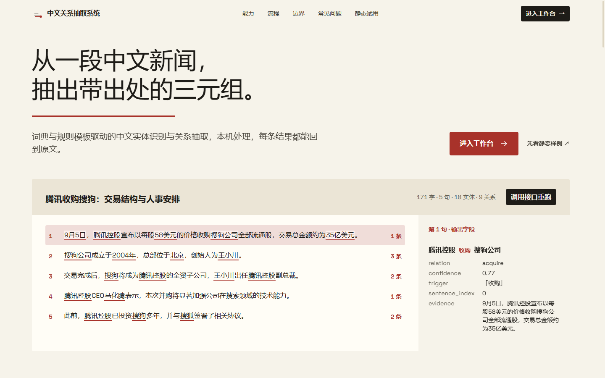

---

## 一、功能一览

| 需求 | 实现 |
| --- | --- |
| **文本输入** | 支持粘贴长文本（≤ 20000 字），或上传 `.txt / .md / .text / .pdf / .docx` 文件（≤ 2MB，64KB 分块读取）；纯文本自动识别 UTF-8 / GB18030（含 GBK）/ UTF-16 / BIG5，按 CJK 占比与乱码特征给候选解码打分取最优；PDF 与 DOCX 用本地解析库取文字层，全程离线不联网 |
| **实体识别** | 识别人物、组织机构、地理位置、时间、金额、产品技术共 **6 类实体**，正文中彩色高亮 + hover 显示类型与置信度 + 侧栏实体清单，可按类型显隐 |
| **关系抽取** | 输出 `<头实体, 关系, 尾实体>` 三元组，覆盖收购、投资、任职于、总部位于、创立、合作、签署协议等 **19 类关系**，每条结果附带置信度、触发词、证据句与所用规则；内置**轻量指代消解**（"该工厂 / 双方 / 后者"自动回指到真实实体）与**主语链继承**（"……并与 B 签署……"继承上一分句主语），并在三元组表格中标注"指代消解 / 主语链"规则来源 |
| **实体归一** | 机构名递归剥离"有限公司 / 集团 / 控股"等后缀（腾讯控股有限公司 → 腾讯），同一实体的多种写法在图谱、清单与统计中合并为一个节点，清单上以角标提示已合并 |
| **结果可视化** | ① 三元组表格（按关系类型/置信度过滤、关键词搜索、展开行查看完整证据句）② ECharts 力导向/环形关系图（可拖拽、缩放、合并同义实体）③ 统计洞察（实体/关系分布、句级关系数、全库累计） |
| **结果导出** | 右上角统一导出菜单：三元组 **CSV**（带 BOM，Excel 打开不乱码，表头含规范化名）、完整 **JSON**、**Markdown** 分析报告、**GraphML**（Gephi / yEd / NetworkX 直接打开）、**Neo4j Cypher**（MERGE 语句，含证据与置信度属性）、关系图谱 **PNG**、**单文件离线 HTML 报告**（内嵌样式与静态 SVG 图，无脚本、无外链，双击即看）、**完整项目包 JSON** |
| **历史记录** | 页面初始化时的示例抽取仅作预览、**不写库**（避免刷新产生重复记录）；主动抽取或点击「存入历史」才入库，支持 FTS5 `trigram` 中文子串检索（短词自动回退 LIKE）、标签精确筛选、分页、载入复现、单条删除与一键清空 |
| **人工校正** | 三元组表格支持新增、修改、删除、**撤销 / 重做**（按钮与 `Ctrl/⌘ + Z`、`+ Shift + Z`）；点「保存校正」写回历史，保存后提示新增 / 删除条数，`rule_base` 区分自动与手工，人工行标注「人工」；实体清单的「校正」入口可改**实体边界、类型与归一写法**、增删实体，改动写入 `entity_corrections` 留痕；人工新增关系带进来的实体会随三元组一起回写记录快照与计数，未指定证据句的关系记为 `-1` 而不是错指到第 0 句；预览态可直接「保存为新记录」，已有记录也能「另存副本」不覆盖原件 |
| **批量抽取** | 同步模式一次最多 20 篇：多文件上传（编码逐个自动识别）或按空行分隔的多段文本；文本模式可切「**后台运行**」，最多 100 篇，提交后立即返回任务 id，前端每 500ms 轮询 `/api/tasks/{id}` 显示进度，关掉对话框不中断执行；逐篇显示实体数 / 关系数 / 耗时，单篇失败不打断整批，并给出**跨文档聚合**（高频实体、高频关系、高频三元组） |
| **跨文档知识库** | 「知识库」对话框三页签：① **全局实体**——按名字/类型检索，画像里列出别名、参与的全部关系、来源文档与首次/最近出现时间，可载入该记录或在当前工作台按实体筛选；② **跨文档图谱**——把多份文档的关系按归一化实体名合并成一张全局网络，可按关系类型收敛；③ **标签与复核**——给记录打标签、查看**跨文档关系冲突**（同一实体对被判成不同关系）与**低置信度复核队列**（默认阈值 0.8）。全局实体直接查 `relations` 的归一字段，不另建实体表，因此人工校正/删除/导入后无需同步 |
| **质量闭环** | ① **界面化评测台**——一键跑 P/R/F1 与 Macro-F1，展示命中/误抽/漏抽、F1 回归曲线、分关系类型指标、逐条用例与漏抽/误抽明细，也支持传入自定义金标准；② **规则实验室**——给一段文本填候选触发词，做基线与候选的 A/B 试跑并列出「新增 / 消失 / 不变」三栏 diff，试跑不落库、不改当前配置；③ **配置版本**——把当前触发词与词典存成快照，一键回滚并立即热更新索引；评测历史与快照都进库 |
| **复核 → 定稿 → 分享** | 顶栏「复核」显示进度（已复核 / 总数），对话框里逐条给三元组打「通过 / 存疑 / 驳回」并写批注，可按结论筛选；状态按 `draft → in_review → final` 流转，**定稿生成不可变快照并锁定**关系与实体的写入（后端 409 兜底），要改稿先「解锁」退回复核中；三元组表格同步显示复核徽标；复核结论会一起写进单文件 HTML 报告与只读报告页 |
| **上线最小安全集** | CORS 默认只放行本机开发源（不再 `*`）、per-IP 滑动窗口限流、全局请求体上限、上传扩展名 + magic bytes 双检、PDF 页数上限与解析硬超时、DOCX 解压体积检查、结构化访问日志与 `X-Request-ID`；只读报告页 `noindex` + `private, no-store`，分享链接由服务端 HMAC 签名并带有效期（生产配置 `APP_REPORT_SECRET` 后强制校验）；完整配置清单与生产 checklist 见 `backend/.env.example` |
| **离线交付与集成** | `POST /api/report` 生成**单文件 HTML**（统计卡 + 静态环形关系图 + 类型分布 + 三元组证据 + 复核结论 + 原文，断网可看）；`/report/{id}` 是**独立只读页**，不加载任何前端 JS，点「复制只读报告链接」拿到的是带签名与有效期的 URL；**项目包**把记录、三元组、实体校正、词典、触发词、规则版本、评测历史与金标准打成一份 JSON，`merge` 追加或 `replace` 覆盖导入；PDF / DOCX 走本地解析库取文字层 |
| **结果深链** | `/app?record=12#triples` 直接复现历史记录，`?q=实体名` 带三元组筛选；点「复制分享链接」把当前结果、页签与筛选一起写进 URL |
| **领域配置** | 界面可增删**自定义实体词条**（人物 / 机构 / 地名 / 产品等）与**自定义关系触发词**（给 19 类内置规则追加领域说法），两者都是保存后下一次抽取立即生效，无需改代码或重启；可保存/回滚配置版本，句式模板仍由代码维护 |
| **效果评测** | `eval/` 下提供 10 段人工标注金标准集；CLI（`eval/run_eval.py --json`）与界面评测台共用同一套 `app/nlp/evaluation.py` 算法，输出整体与分类型指标及漏抽/误抽明细，界面侧额外保留历史回归曲线 |
| **交互体验** | 内置 4 条中文新闻示例（一键切换并自动抽取）、空状态引导、字数计数、错误提示、响应式布局（≤1120px 单列，≤720px 顶栏与页签自动换行且 390px 无横向溢出）；结果与证据双向联动（表格→原文定位、图谱→三元组下钻、统计→原文定位）；结果就绪后左栏自动收窄为摘要卡；长文本按 40 块分批挂载并配抽取骨架屏；图谱超过 80 个节点自动降级为环形布局并关闭力导向动画与标签 |

### 界面截图

首页的能力切换器与纸墨朱主视觉价值段（点击左侧任一项，右侧详情常驻，不随鼠标移动而消失）：

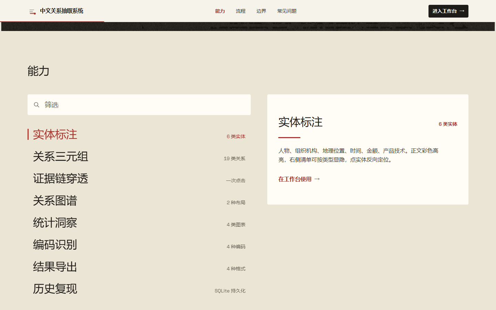

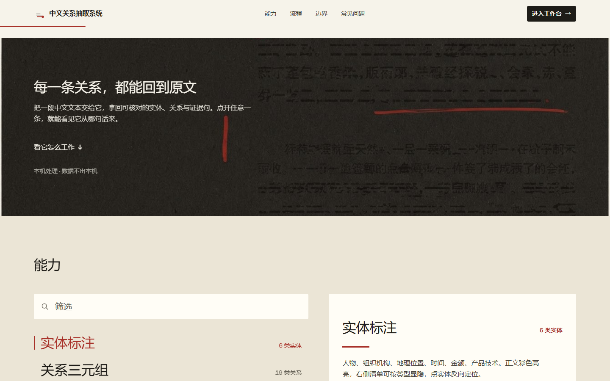

工作台全貌与四个视图（1440×900 实际截图）：

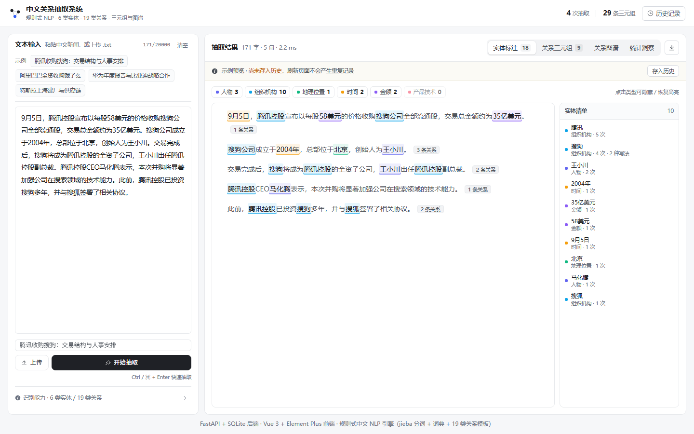

| 关系三元组 | 关系图谱 |
| --- | --- |
| 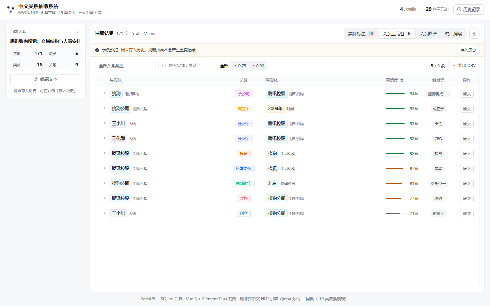 | 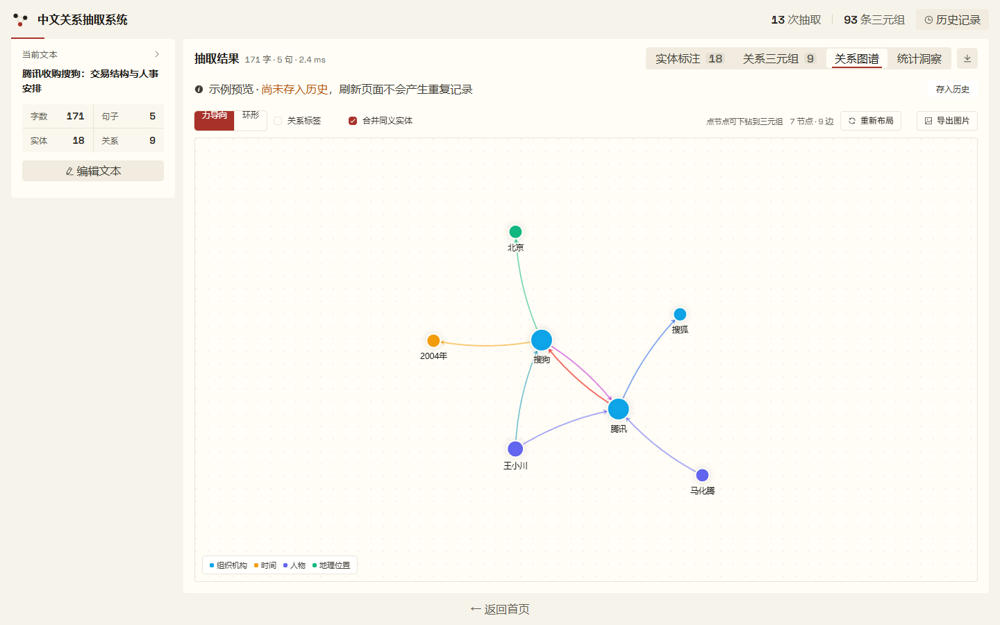 |

| 统计洞察 | 历史记录 |
| --- | --- |
| 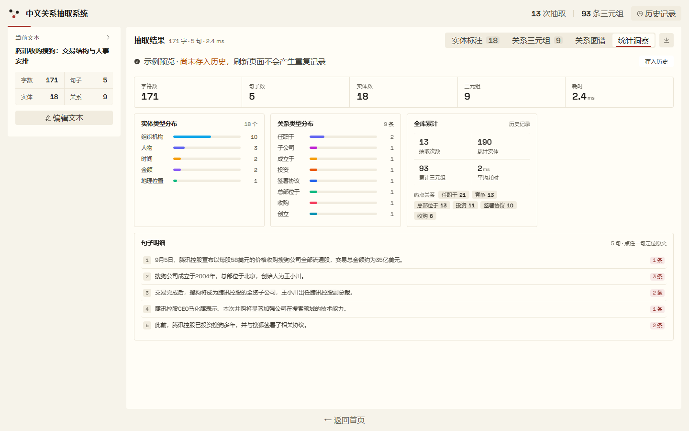 | 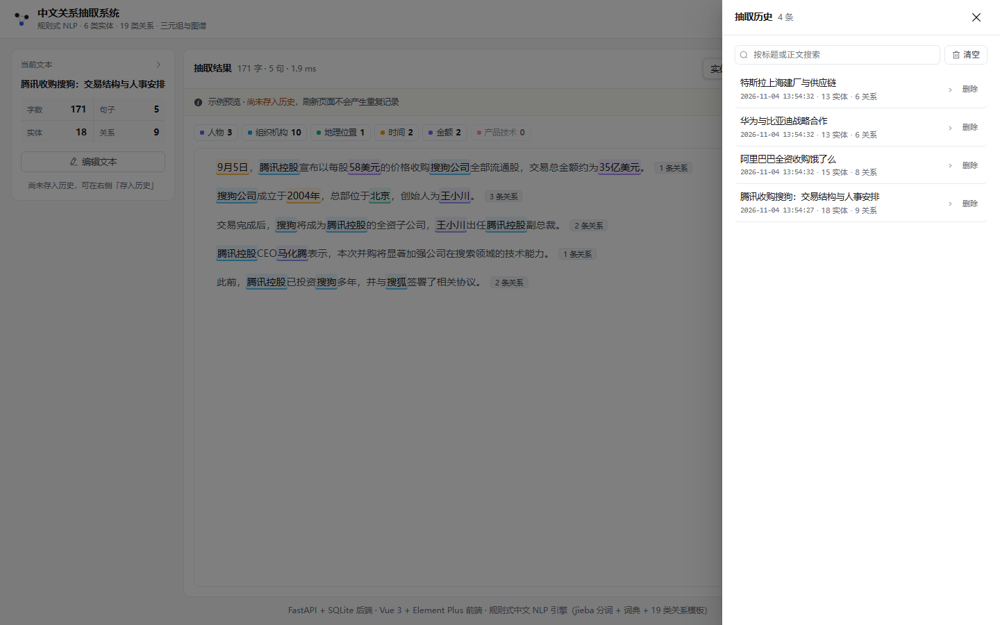 |

人工校正态：表格里带「人工」标记的行、撤销 / 重做、保存校正与「另存副本」都在同一条工具栏上。

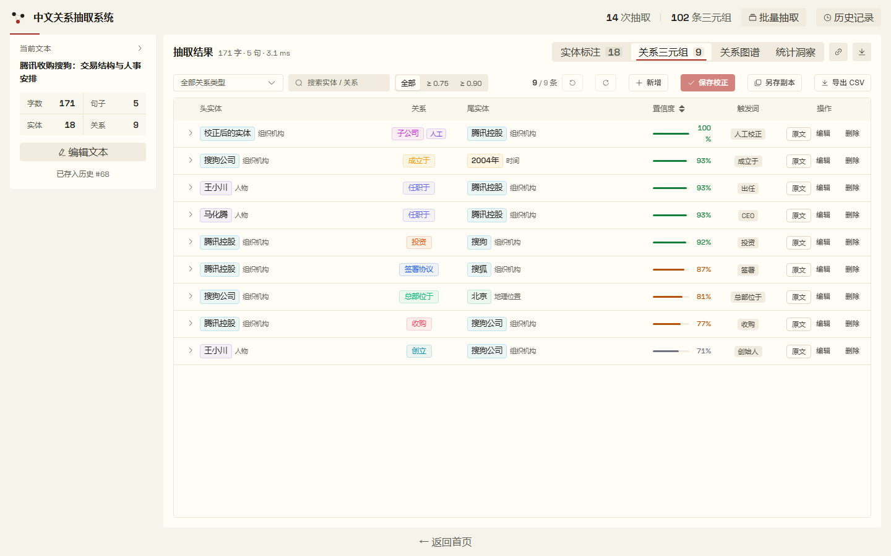

1.3.0 新增的三个工具界面（均为 1440×900 实际截图，不是示意图）：

| 知识库：全局实体画像 | 界面化评测台 |
| --- | --- |
| 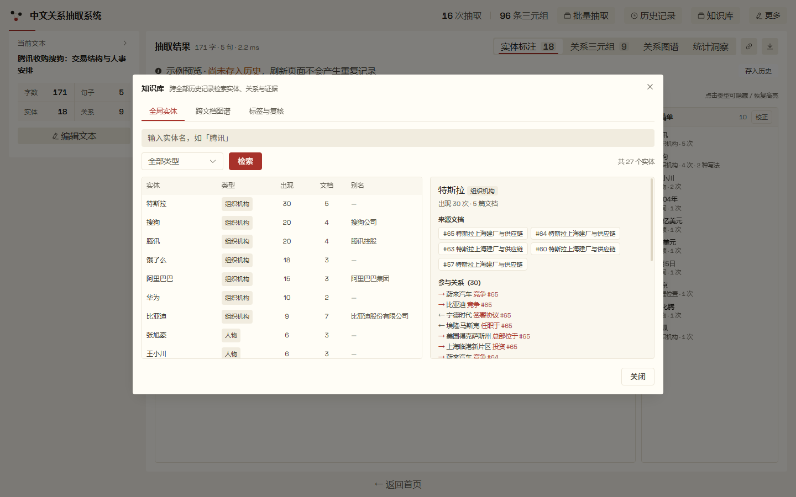 | 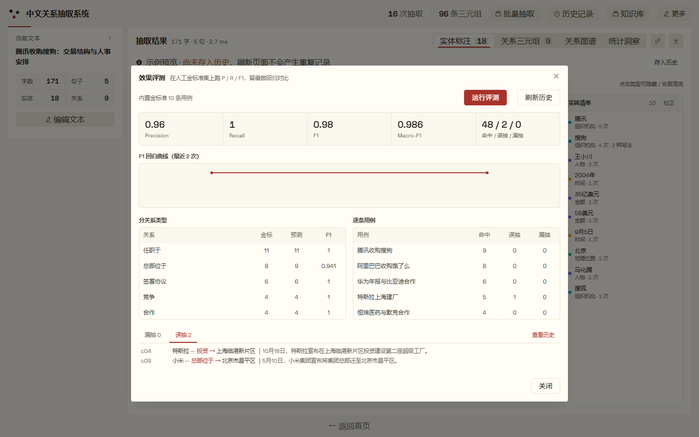 |

规则实验室：同一段文本上试跑候选触发词「吃下」，得到「当前 1 条 / 候选 2 条 / 新增 1 / 消失 0」的 A/B diff。

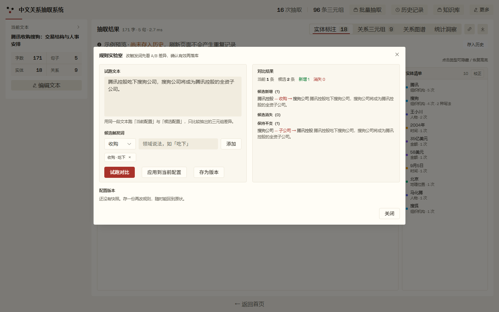

1.4.0 新增的复核台（1440×900 实际截图）：进度条、逐条结论、批注与状态流转集中在同一个对话框，三元组表格里也会同步显示复核徽标。

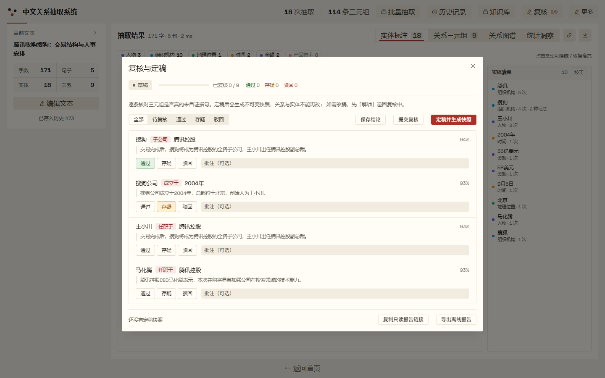

两个交互设计点（截图里是静态的，实际是联动的）：

- **证据链穿透**：三元组行的「原文」按钮 → 跳到实体标注视图并高亮该证据句；图谱节点 → 切到三元组并带上「实体：腾讯 ✕」筛选；统计页句子行 → 定位到原文。目的是把「这条关系凭什么抽出来」的核对成本压到一次点击。
- **输入 / 结果自适应配比**：抽取完成后左栏从 396px 收窄为 236px 摘要卡（标题 + 字数/句/实体/关系），阅读区宽度增加约 40%，`Ctrl/⌘ + E` 随时展开；≤1120px 自动禁用，保持单列布局。

界面语言按一套固定纪律构建，不是逐处调出来的：

- **支点**：每一条抽取结果都钉在原文的某句话上。界面因此按校对稿设计，正文是原件（全界面唯一 16px 阅读字号），彩色只负责标出证据位置，表格和图谱是批注的索引。
- **共享字阶**：首页 14 / 16 / 20 / 32 / 56 五档与工作台三档都引用 `:root` 的 `--brand-scale-*`；工作台密集表格保留 12px caption 密度对；间距只用 2 / 4 / 8 / 12 / 16 / 24 / 32 / 48；圆角全站一个决定，4px。
- **两页共用一张纸**：品牌色值只在 `styles.css` 的 `:root` 定义一次（纸底 `#f6f3ea` / 纸面 `#fffdf6` / 纸影 `#ebe5d6` / 墨 `#1e1c18` / 灰墨 `#615d52` / 朱 `#a8322a` / 深墨 `#201e19`），首页、工作台、404 与 Element Plus 皮肤都引用同一组 `--brand-*`；层次靠纸色明度阶而不是描边，19 类实体与关系的数据色保持独立不动。
- **动效统一**：`styles.css` 的 `:root` 是全站唯一节奏源 —— 单一曲线 `cubic-bezier(0.22, 1, 0.36, 1)`、六档时长（按压 140 / 交换 200 / 状态 300 / 位移 500 / 显现 700 / 扫光 600ms），首页与工作台不再各写一套 ms；只动 `transform` 与 `opacity`，`prefers-reduced-motion` 下只留终态。
- **三处跨页签名**：抽取完成时结果容器一次入场 + 朱红扫光；页签指示条按真实 `offsetLeft` 单条滑动；点三元组定位证据句时句下朱线划入。高频列表（句子 / 表格 / 下拉项）不做 stagger，切页签不重播入场。
- 西文与数字用本地引入的 Space Grotesk（latin 子集 22KB），中文回退系统栈，数字统一 `tabular-nums`。

### 首页：可交互的产品入口

上面那套纪律是工作台的。首页是另一种模式（Persuade），不复用工作台布局：它是产品落地页，只有一个主行动「进入工作台」。这一版按「交付产品」而不是「作业汇报」重做——**评测区块、指标行、规格表、各段说明句、课程作业字样与操作提示全部摘除**，能靠界面表达的不再写成文字。

方向仍由 `design-taste-frontend` 的 `draw.mjs --sector dev-tool --direction borrowed-category`（seed `687035355`）抽出，借用类别为**中文报纸的校样**。这套身份只保留在视觉层（纸色、红笔、边注栏），不进入任何可见文案。

- **色纸世界**：纸底 `#f6f3ea`、纸面 `#fffdf6`、墨 `#1e1c18`、校改红 `#a8322a`；首页与工作台共用这套色值，朱红同时承担主按钮、焦点环、页签指示条与证据句定位，19 类数据色只负责标出实体位置。
- **排版令牌**：字号 5 档 `14 / 16 / 20 / 32 / 56`，56px 只出现在首屏一处；中文大标题 `letter-spacing: 0`、`line-height: 1.16`、`font-weight: 500`；正文 `16px / 1.63`、`max-width: 34em`；断点 56 → 40 → 32 渐进；`line-break: strict` 与 `text-spacing-trim: space-first`。
- **两个创新模块**（单页上限 2 个，其余全走标准控件）：① **接口契约面板**——点左侧句子，右侧列出 `relation / confidence / trigger / sentence_index / evidence` 的真实字段值，「调用接口重跑」打 `/api/extract` 并回显 HTTP 状态、句数、关系数与实测往返耗时；② **纸墨朱主视觉价值段**——按 2026-11-11 加入的 Figma 工作流，用 Figma AI 生成深墨纸纹与朱红批注笔触（额度耗尽/失败才降级 ImageGen），接替被删除的「运行」命令屏、保住首页明暗节奏；图内无可读文字与 Logo。
- **常驻详情切换器**（标准控件 + 动效，不新增交互范式）：能力区块改成左右分栏。原先 `@mouseenter` 把选中态绑在鼠标上，鼠标一动展开的说明就跟着跑甚至消失，卡片下半截长期空白；现在点击或上下方向键固定选中，hover 只做视觉，右侧详情卡常驻并跟随滚动（`position: sticky`），内容用交叉淡入替换，红色指示条按真实行位置滑动。
- **动效层**（按 `animate` 规范：只用 `transform / opacity / clip-path`，沿用项目 `--ease`）：首屏标题遮罩上浮 + 红笔划线 draw；分区入场分三型编排（标题遮罩揭开 / 卡片 0.97 缩放 / 列表横向错峰，30–80ms stagger）；句子选中指示条滑动 + 右侧字段交叉淡入与错峰；能力切换的指示条位移与详情交叉淡入；接口重跑成功的一次性红色扫光；顶部滚动进度线；按钮按压从 500ms 修到 140ms。`prefers-reduced-motion` 下全部关闭且内容默认终态可见，hover 变换只在 `pointer: fine` 生效。可见性用 `getBoundingClientRect()` 在 `requestAnimationFrame` 里主动判定，不依赖 `IntersectionObserver` 的阈值穿越——整屏跳滚时元素会从视口下方直接跨到上方，两端都不相交，IO 一次都不回调。
- **叙事顺序**：首屏 → 接口契约面板 → 价值段 → 能力 → 真实输出样例 → 处理流程 → 四视图截图 → 适用范围 → FAQ → 整条 CTA → 页脚。
- **设计门禁**：`lint.mjs` **0 FAIL / 0 WARN**；`inspect.mjs`（生产构建 1440 / 768 / 390）**0 FAIL / 2 WARN**，实测字号 `14/16/20/32/56`、`tracking 0em`、`leading 1.16`。保留的两条 WARN 是主动选择：`palette-cream` 因为暖纸色正是「校样」这一借用类别的身份；`no-footage` 因为项目没有真实拍摄素材，硬塞录屏会违背「首页只用真实产物」，改由可交互面板与真实界面截图承担证据。

---

## 二、技术栈

| 层次 | 选型 | 说明 |
| --- | --- | --- |
| 前端框架 | Vue 3（`<script setup>` 组合式 API） | 组件化拆分工作台 / 标注 / 表格 / 图谱 / 统计 / 历史抽屉 |
| UI 组件库 | Element Plus 2.8（中文 locale） | 输入、表格、抽屉、分页、消息提示等 |
| 可视化 | ECharts 5（graph 关系图） | 力导向与环形两种布局，支持拖拽与导出 |
| HTTP | Axios | 统一拦截后端 `detail` 错误信息 |
| 构建 | Vite 5 | 开发代理 `/api` → `127.0.0.1:8000`，产物 `dist/` |
| 后端框架 | FastAPI（Pydantic v2 校验） | 自动生成 OpenAPI 文档 `/docs` |
| 服务器 | Uvicorn | 单进程即可同时托管 API 与前端静态资源 |
| 数据库 | SQLite（标准库 `sqlite3`） | 零配置，`backend/data/app.db` 单文件持久化 |
| NLP | jieba 0.42 + 自建词典 + 正则规则 | 纯规则流水线，无需下载模型，毫秒级响应 |
| 文档解析 | PyMuPDF（`pymupdf`）+ `python-docx` | 可选依赖，只用于 PDF / DOCX 的本地文字层提取；不做 OCR、不联网，缺失时仅这两种格式报明确错误 |

---

## 三、目录结构

```
软件工程作业（修改框架版）/
├─ backend/
│  ├─ app/
│  │  ├─ main.py              # FastAPI 入口：SPA 托管、GZip、CORS、限流/体限/日志、路由注册
│  │  ├─ db.py                # SQLite 建表、幂等迁移、FTS5、增量计数、批量聚合
│  │  ├─ store.py             # 知识库/质量/交付查询层：全局实体、图谱、冲突、
│  │  │                       #   评测历史、规则版本、任务状态、项目包导入导出
│  │  ├─ security.py          # 来源白名单、限流、请求体上限、报告分享 HMAC 签名
│  │  ├─ review_store.py      # 复核决策、状态流转、定稿快照（独立存储层）
│  │  ├─ report.py            # 单文件离线 HTML（内嵌 CSS + 静态 SVG + 复核结论区）
│  │  ├─ samples.py           # 4 条内置中文新闻示例
│  │  ├─ nlp/
│  │  │  ├─ lexicon.py        # 实体词典、19 类关系规则、句式模板、触发词热更新
│  │  │  ├─ tokenizer.py      # 分句 + jieba 分词（注入自定义词典）
│  │  │  ├─ entity.py         # 实体识别（词典/后缀/上下文/词性 四通道 + 重叠消解）
│  │  │  ├─ relation.py       # 关系抽取（句式模板优先、触发词扫描兜底、去重与置信度）
│  │  │  ├─ evaluation.py     # P/R/F1 评测核心，CLI 与界面评测台共用
│  │  │  └─ pipeline.py       # analyze(text, custom_terms, custom_triggers) 流水线出口
│  │  └─ routers/
│  │     ├─ extract.py        # /api/extract、/extract/file、/extract/batch*、/api/health
│  │     ├─ meta.py           # /api/records（含人工校正、标签筛选）、/stats、/samples、/schema
│  │     ├─ dictionary.py     # /api/dictionary 自定义实体词条增删查
│  │     ├─ rules.py          # /api/rules 自定义关系触发词增删查 + 内置规则目录
│  │     ├─ knowledge.py      # 全局实体、画像、跨文档图谱、标签、冲突、复核队列
│  │     ├─ quality.py        # 评测台、规则 A/B 试跑、配置版本、实体级校正
│  │     ├─ review.py         # 复核状态、逐条结论、定稿快照（/api/records/{id}/review/*）
│  │     └─ delivery.py       # HTML 报告、签名分享、/report/{id}、项目包、后台任务
│  ├─ data/app.db             # SQLite 运行时数据（WAL 模式；已移出 git 跟踪）
│  ├─ .env.example            # 生产配置清单与最小 checklist（代码不自动加载 .env）
│  ├─ devtools/check.py       # 离线自检脚本：对内置示例跑抽取并打印结果
│  ├─ eval/
│  │  ├─ gold.json            # 10 段人工标注金标准集（48 条三元组，14 类关系）
│  │  ├─ run_eval.py          # CLI 入口，调用 nlp/evaluation.py（--json 可机读输出）
│  │  └─ REPORT.md            # 评测报告：指标、分类型结果、错误分析
│  ├─ tests/                  # pytest API 回归测试（67 条，临时库隔离）
│  │  ├─ conftest.py          # 每个用例把 db.DB_PATH 指向 tmp_path，不碰真实 app.db
│  │  ├─ test_api.py          # 抽取/上传编码/错误码/静态路径穿越（16 条）
│  │  ├─ test_features.py     # FTS5/增量计数/批量/自定义规则/健康信息（12 条）
│  │  ├─ test_features_v13.py # 知识库/质量闭环/离线交付/后台任务/PDF·DOCX（18 条）
│  │  ├─ test_corrections.py  # 词典/快照/人工校正 P1 回归（9 条）
│  │  └─ test_features_v14.py # 安全集与复核定稿闭环（12 条）
│  ├─ pytest.ini              # testpaths 与 pythonpath
│  ├─ ruff.toml               # 只开 F / E9，聚焦未定义名与未使用导入
│  ├─ requirements.txt        # 含可选本地解析库 pymupdf / python-docx
│  └─ requirements-dev.txt    # pytest + httpx + ruff
├─ .github/workflows/ci.yml   # push / PR 跑依赖锁校验、ruff、pytest、F1 门槛与 npm build
├─ frontend/
│  ├─ src/
│  │  ├─ App.vue              # 站点分流 + 工作台（校正栈、深链、复核进度、导出、工具入口）
│  │  ├─ main.js / styles.css # 按入口挂载、全站设计系统（仅 /app 加载组件库）
│  │  ├─ element-setup.js     # Element Plus 按需注册 + 中文 locale（工作台动态 chunk）
│  │  ├─ element-overrides.css# 组件库皮肤覆盖，排在组件库 CSS 之后加载
│  │  ├─ api/client.js        # Axios 封装（抽取/批量/记录/规则/知识库/质量/交付）
│  │  ├─ utils/export.js      # 导出构建：CSV / JSON / MD / GraphML / Cypher
│  │  ├─ data/landing-demo.json # 首页演示数据：pipeline 真实抽取结果与关系目录
│  │  └─ components/
│  │     ├─ LandingPage.vue    # 产品首页：接口契约面板、价值段、能力切换器、CTA
│  │     ├─ TextWorkbench.vue   # 文本输入、示例、上传（含 PDF/DOCX）、清空
│  │     ├─ EntityAnnotator.vue # 正文实体高亮 + 长文本分批渲染 + 实体校正入口
│  │     ├─ TripleTable.vue     # 三元组表格（过滤/校正/复核徽标/定稿锁定/导出 CSV）
│  │     ├─ RelationGraph.vue   # ECharts 关系图（大图自动降级环形布局）
│  │     ├─ StatsOverview.vue   # 指标卡、类型分布、句级统计、全库累计
│  │     ├─ HistoryDrawer.vue   # 历史记录抽屉（检索/载入/删除/清空）
│  │     ├─ DictionaryDialog.vue# 实体词典与关系触发词两个配置页
│  │     ├─ BatchDialog.vue     # 批量抽取：文件/文本队列、后台任务进度、跨文档聚合
│  │     ├─ KnowledgeDialog.vue # 知识库：全局实体 / 跨文档图谱 / 标签与复核
│  │     ├─ EvalDialog.vue      # 评测台：指标卡、F1 回归曲线、漏抽误抽明细
│  │     ├─ RulesLabDialog.vue  # 规则实验室：A/B diff、应用、版本保存与回滚
│  │     ├─ EntityFixDialog.vue # 实体级校正：边界 / 类型 / 归一写法与增删
│  │     └─ ReviewDialog.vue    # 复核台：逐条结论、批注、状态流转、定稿与分享
│  ├─ public/                 # favicon.svg、fonts/（本地西文字体）、media/（首页视图裁切图）
│  ├─ dist/                   # 生产构建产物，后端单端口托管
│  └─ index.html / vite.config.js / package.json
├─ docs/screenshots/          # 首页 3 张 + 工作台 10 张实际截图
└─ README.md
```

---

## 四、快速开始

### 1. 环境要求

- Python **3.10+**（开发与验证环境：3.11.9）
- Node.js **18+**（开发与验证环境：v24.17.0）、npm

### 2. 启动后端

```bash
cd backend
python -m pip install -r requirements.txt
python main.py                # 一键启动（推荐），访问 http://127.0.0.1:8000
# 可选参数：python main.py --port 9000 ｜ python main.py --reload（开发热更新）
# 等价旧方式：python -m uvicorn app.main:app --reload --port 8000
```

`requirements.txt` 里的 `pymupdf` 与 `python-docx` 只用于 PDF / DOCX 上传的本地文字层解析；纯文本抽取不依赖它们，未安装时这两种格式会返回明确的错误提示，其余功能不受影响。所有解析都在本机完成，不上传、不调用云端模型。

- 接口文档：<http://127.0.0.1:8000/docs>
- 健康检查：<http://127.0.0.1:8000/api/health>（`version` 为 `1.4.0`）
- 只读报告示例：<http://127.0.0.1:8000/report/12>（记录存在时返回完整离线报告页）

### 3A. 前端开发模式（热更新）

```bash
cd frontend
npm install
npm run dev
```

打开 <http://localhost:5173>（Vite 默认绑定 `localhost`，若用 `127.0.0.1` 无法访问请改用 `localhost`），Vite 会把 `/api` 代理到 `127.0.0.1:8000`。

### 3B. 生产模式（单端口，推荐用于演示）

```bash
cd frontend
npm install
npm run build          # 产物输出到 frontend/dist
cd ../backend
python -m uvicorn app.main:app --port 8000
```

后端检测到 `frontend/dist` 后会自动托管静态资源，**直接访问 <http://127.0.0.1:8000/> 首页即可**（无需另起前端服务）；点「进入工作台」或访问 <http://127.0.0.1:8000/app> 开始抽取。上传前请确认 `dist/` 中有 `favicon.svg`、`fonts/`、`media/` 与最新 `assets/`，它们都是首页所需资源。

### 3C. 对外部署的最小配置

本机零配置即可跑；挂到公网前请按 `backend/.env.example` 用环境变量注入以下值（代码不自动读取 `.env` 文件）：

| 变量 | 作用 |
| --- | --- |
| `APP_ALLOWED_ORIGINS` | 跨域白名单，默认只放行本机 8000 / Vite 5173，生产填自己的域名 |
| `APP_API_TOKEN` | 设置后所有非只读 `/api` 请求须带 `X-API-Token` |
| `APP_REPORT_SECRET` | 报告分享签名密钥；**设置后裸 `/report/{id}` 一律 403**，链接必须带有效签名与过期时间 |
| `APP_RATE_LIMIT_PER_MIN` | 每个 IP 每分钟 `/api` 与 `/report` 请求上限，默认 120 |
| `APP_MAX_BODY_BYTES` | 全局请求体上限，默认 4 MB（单文件另受 2 MB 限制） |
| `APP_PARSE_TIMEOUT` | PDF / DOCX 本地解析硬超时，默认 10 秒 |

再确认：HTTPS 由反向代理终止、服务只监听本机端口、后端以单进程运行、`backend/data/` 定期备份（含 `.report-secret`，否则已发出的分享链接会全部失效）。

### 4. 离线自检（无需启动服务）

```bash
cd backend
python devtools/check.py
```

脚本会对 4 条内置示例执行抽取，打印实体数与三元组明细，用于回归验证 NLP 模块。

### 5. 效果评测

```bash
cd backend
python eval/run_eval.py            # 表格报告 + 漏抽/误抽明细
python eval/run_eval.py --json     # 机读格式，便于接入 CI
```

在 `eval/gold.json` 的 10 段人工标注文本（1 283 字 / 48 条三元组 / 14 类关系）上计算 Precision / Recall / F1。当前结果 **P 0.960 · R 1.000 · F1 0.980 · Macro-F1 0.986**（机制改进前的基线为 F1 0.769，见第九节），完整的分类型指标与错误分析见 [`backend/eval/REPORT.md`](backend/eval/REPORT.md)。

工作台顶栏「更多 → 效果评测」是同一套算法的界面入口，额外保留每次运行的 F1 回归曲线与漏抽/误抽明细，也支持粘贴自定义金标准跑单次评测；`POST /api/eval` 与 CLI 都调用 `app/nlp/evaluation.py`，不会出现两套 P/R/F1 口径。

### 6. 接口回归测试

```bash
cd backend
python -m pip install -r requirements-dev.txt
python -m ruff check app tests   # lint 门禁
python -m pytest -q              # 67 passed
python eval/run_eval.py --json   # F1 ≥ 0.95
```

这三步与 `.github/workflows/ci.yml` 里 GitHub Actions 的 backend job 完全一致（另外还有 frontend job 跑 `npm ci && npm run build`）；`ruff.toml` 只开 `F` / `E9`，聚焦未定义名、未使用导入与语法错误这类会让程序悄悄坏掉的问题。

`tests/conftest.py` 在每个用例里把 `db.DB_PATH` 指向 `tmp_path` 下的临时库，测试不会污染 `backend/data/app.db`。

- `test_api.py`（16 条）：内置示例结果基线（18 实体 / 9 三元组）、空文本 400、超限 413、非法扩展名 415、记录不存在 404、`save=false` 不写库、UTF-8 / GBK / BIG5 / UTF-16 上传后逐字比对、SPA 静态路由不能把源码 / README / 数据库拖走。
- `test_features.py`（12 条）：FTS5 中文子串检索与语法字符降级、增量计数在保存 / 校正 / 删除 / 清空后与库内真值一致、批量文本与批量文件（混合编码）、单篇失败不打断整批、自定义触发词热生效与删除后失效、规则校验、健康信息字段、快照校正写回。
- `test_features_v13.py`（18 条）：全局实体画像与跨文档图谱合并、标签设置与筛选、冲突检测、低置信度复核队列、评测接口与历史、自定义金标准、规则 A/B 试跑不落库、配置版本回滚、实体级校正写回、单文件离线 HTML（无脚本外链）、只读报告页、项目包 merge / replace 导入、后台批量任务进度与结果、PDF / DOCX 本地解析上传。
- `test_corrections.py`（9 条）：词典 / 快照 / 人工校正的 P1 回归。
- `test_features_v14.py`（12 条）：CORS 默认白名单、复核状态与结论汇总、状态机必须走 `/finalize`、定稿锁定三处写接口与快照不可变、报告含复核区块与只读页 `noindex`、签名强制模式与过期拒绝、请求体上限、per-IP 限流、伪造 magic bytes 拒绝、PDF 页数上限、删除 / 清空连带清理复核数据。
- `test_corrections.py`（9 条）：自定义词典 CRUD 与热生效、非法词条 400、快照往返、人工校正往返（`sentence_index: null` 落库为 -1）、人工新增关系的实体快照回写、非法关系 400、清空全部关系。

---

## 五、NLP 实现原理

### 5.1 流水线

```
原始文本
  │ ① 分句：按 。！？；!? 与换行切分并保留字符偏移，合并过短碎片
  │ ② 分词：jieba.posseg 词性标注；启动时把词典中的机构/人名/地名/产品全部注入用户词典
  │ ③ 实体识别：四条通道并行产出候选，再统一消解
  │      · 词典精确匹配（机构、地名、人名、产品名录）
  │      · 后缀构词（"…有限公司 / …大学 / …研究院"；"…省 / …市 / …区"；
  │        机构名不从地名上扩展，避免"德国默克集团"被粘成"德国默克集团"）
  │      · 上下文正则（"CEO 张勇"、"张勇表示"、"由 王小川"）
  │      · 词性规则（nr/nrfg → 人物，ns → 地名，nt → 机构，nz → 产品）
  │     → 同位置去重、按长度与来源优先级消解重叠、过滤泛称（"子公司/该集团"）
  │ ④ 指代消解（DocumentContext，跨句维护）：
  │      · "该工厂/该公司" —— 依据 "投资建设了 XX 工厂" 的归属登记回指到主体
  │      · "双方/两者" —— 句内最近的两个机构，不足时回溯全文最近两机构
  │      · "后者/前者" —— 句内最近一组并列实体（"A 与 B"）中对应的一方
  │     → 指代词生成"伪实体"参与匹配，落地后替换为真实实体，不进入输出
  │ ⑤ 关系抽取：句内执行
  │      · 句式模板优先（如「{0}成为{1}的全资子公司」「{1}的CEO是{0}」）置信度 0.96
  │      · 触发词扫描兜底（收购 / 投资 / 出任 / 总部位于 …）按距离取最近且类型兼容的实体对
  │      · 主语链：分句以"并/且/也"开头时头实体继承上一分句主语
  │      · 隐性竞争："挤压/蚕食/抢占…市场份额"主语取全文话题实体
  │      · 被动（"被…收购"）、并列（"华为与比亚迪签署"）、后置定语（"总部位于杭州的A公司"）
  │ ⑥ 归一化与去重：(头, 关系, 尾) 取最高分、去除自环、按置信度排序、
  │    机构名去后缀生成 canonical；"总部位于" 覆盖泛化的 "位于"，
  │    "签署协议" 覆盖同向的 "供应"（供货协议类名词短语不再当作供应事件）
  ▼
{ entities, relations, entity_type_counts, relation_type_counts, stats }
```

### 5.2 实体类型

| key | 类型 | 颜色 | 识别依据 |
| --- | --- | --- | --- |
| `PERSON` | 人物 | 靛蓝 | 姓氏表（406 个姓氏 + 复姓）、职位上下文、言说动词、jieba `nr` |
| `ORG` | 组织机构 | 天蓝 | 机构后缀构词、机构名录、jieba `nt`、英文公司后缀（Inc/Corp/Group/Ltd） |
| `LOC` | 地理位置 | 青绿 | 行政区划后缀（省/市/区/县/州）、地名词典、jieba `ns` |
| `TIME` | 时间 | 琥珀 | `\d{4}年`、`\d{1,2}月\d{1,2}日`、"今年以来"等 |
| `MONEY` | 金额 | 紫 | 数字 + 亿美元/亿元/万元/元（排除"20 万名员工"等量词误判） |
| `PRODUCT` | 产品技术 | 玫红 | 产品词典、英文专名、jieba `nz` |

### 5.3 关系类型（19 类）

| key | 关系 | 头 → 尾 类型约束 | 说明 / 触发词示例 |
| --- | --- | --- | --- |
| `acquire` | 收购 | ORG → ORG | 一方取得另一方控制权（收购 / 并购 / 全资收购） |
| `invest` | 投资 | ORG/PERSON → ORG/LOC | 资金换取股权或向某地投资（投资 / 注资 / 建厂） |
| `control` | 控股 | ORG/PERSON → ORG | 持有对方多数股权（控股 / 持股） |
| `subsidiary` | 子公司 | ORG → ORG | 隶属与控股关系（全资子公司 / 成为…的子公司） |
| `employ` | 任职于 | PERSON → ORG | 人物在某组织任职（出任 / 担任 / CEO / 总裁） |
| `appoint` | 任命 | ORG → PERSON | 组织对人物的职务任命（任命 / 委任） |
| `headquarter` | 总部位于 | ORG → LOC | 组织总部所在地（总部位于 / 总部设于） |
| `locate` | 位于 | ORG/LOC → LOC | 实体地理位置（位于 / 坐落于） |
| `found` | 创立 | PERSON → ORG | 人物创建组织（创立 / 创办 / 创始人） |
| `founded_at` | 成立于 | ORG → TIME | 组织成立时间（成立于 / 创建于） |
| `graduate` | 毕业于 | PERSON → ORG | 教育背景（毕业于 / 就读于） |
| `born` | 出生于 | PERSON → LOC | 人物出生地（出生于 / 生于） |
| `cooperate` | 合作 | ORG → ORG | 业务协作（合作 / 战略合作，对称关系） |
| `compete` | 竞争 | ORG → ORG | 市场竞争（竞争 / 对手，对称关系） |
| `supply` | 供应 | ORG → ORG/PRODUCT | 产业链上下游供应（供应 / 供货 / 配套） |
| `sign` | 签署协议 | ORG → ORG | 签署合作协议（签署 / 签订 / 达成协议） |
| `sue` | 诉讼 | ORG/PERSON → ORG/PERSON | 法律诉讼（起诉 / 诉讼 / 索赔） |
| `launch` | 发布 | ORG → PRODUCT | 产品或技术发布（发布 / 推出 / 上线） |
| `belong` | 隶属于 | ORG → ORG | 行政隶属（隶属于 / 隶属） |

### 5.4 置信度计算

```
句式模板命中：0.96
触发词命中：0.93 − min(0.32, 0.013 × 头尾实体距离)
指代消解命中：0.90 − 距离惩罚（"该工厂/双方/后者"回指的三元组）
主语链命中：0.93 − 距离惩罚 − 0.03
修正项：被动句 −0.06 ｜ 并列结构 −0.05 ｜ 后置定语 −0.04 ｜ "的+职位" −0.05
最终夹在 [0.52, 0.98] 区间
```

### 5.5 三个关键工程要点

1. **实体识别必须受分词边界约束。** 早期版本直接对整句套机构后缀正则，`[\u4e00-\u9fa5…]{1,13}公司` 会把「以每股 58 美元的价格收购搜狗公司」整体识别为机构，进而吞掉其余实体、使关系数归零。改为"以 jieba 切分出的 token 为单位向前扩展"后彻底解决。
2. **句内坐标与全文坐标必须统一。** 实体携带的是全文绝对偏移，而模板/触发词匹配在单句内进行，二者混用会导致"永远找不到实体"。抽取前统一换算为句内相对偏移。
3. **泛称与虚词必须过滤。** "全资子公司 / 该公司 / 董事会"等泛称若被当作实体，会抢占头尾位置；同时必须保证触发词不落在实体内部（否则"腾讯**控股**"会被误抽成「王小川 控股 搜狗」）。

---

## 六、接口文档

**基础与抽取**

| 方法 | 路径 | 说明 |
| --- | --- | --- |
| `GET` | `/api/health` | 健康检查：版本（1.4.0）、19 类关系数、自定义词典/触发词规模、记录数、库大小、FTS5 是否启用、并发上限 |
| `POST` | `/api/extract` | 请求体 `{text, title, save}`，返回 `{record_id, result}`；并发超额返回 429 |
| `POST` | `/api/extract/file` | `multipart/form-data` 上传 `.txt/.md/.text/.pdf/.docx`（≤2MB）；纯文本自动识别编码，PDF / DOCX 走本地解析库 |
| `POST` | `/api/extract/batch` | 请求体 `{items: [{text, title}], save}`，最多 20 篇；返回逐篇摘要 + 跨文档聚合，单篇失败不打断 |
| `POST` | `/api/extract/batch/files` | `multipart/form-data` 多文件批量（字段名 `files`），编码逐个识别 |
| `GET` | `/api/records` | 历史记录分页，参数 `limit / offset / keyword / tag`；≥3 字走 FTS5 trigram 索引，短词回退 LIKE；`tag` 精确匹配整个标签 |
| `POST` | `/api/records` | 把当前结果另存为快照（三元组会先做类型与长度校验） |
| `GET` | `/api/records/{id}` | 单条记录详情（含实体与三元组） |
| `PUT` | `/api/records/{id}/relations` | 用人工校正后的三元组整体替换，来源标记为 `manual`；可选 `entities` 一并回写实体快照、`entity_types` 与 `entity_count`；`sentence_index` 显式传 `null` 落库为 `-1`；**已定稿返回 409** |
| `PUT` | `/api/records/{id}/entities` | 实体级校正：替换实体数组并写入 `corrections` 留痕；**已定稿返回 409** |
| `DELETE` | `/api/records/{id}` | 删除单条记录 |
| `DELETE` | `/api/records` | 清空全部记录 |
| `GET` | `/api/stats` | 全库统计：记录数、实体数、三元组数、平均耗时、热门关系、活跃实体 |
| `GET` | `/api/samples` | 内置示例新闻 |
| `GET` | `/api/schema` | 实体类型与关系类型目录（含颜色，供前端渲染） |
| `GET` / `POST` / `DELETE` | `/api/dictionary` | 自定义实体词条：列表、新增（含重复检测）、删除单条 / 清空 |
| `GET` / `POST` / `DELETE` | `/api/rules` | 自定义关系触发词：列表（附 19 类内置触发词）、给某类追加触发词、删除 / 清空 |

**知识库**

| 方法 | 路径 | 说明 |
| --- | --- | --- |
| `GET` | `/api/entities` | 跨文档实体检索，参数 `q / type / limit`；按归一化名合并，返回别名与出现次数 |
| `GET` | `/api/entities/profile` | 实体画像：别名、类型、来源文档、参与的全部关系与出现时间 |
| `GET` | `/api/graph/global` | 跨文档关系网络，参数 `relation / limit`；同实体对跨文档合并 |
| `GET` | `/api/tags` | 全部标签及使用次数 |
| `PUT` | `/api/records/{id}/tags` | 设置单条记录标签（`{tags: [...]}`） |
| `GET` | `/api/conflicts` | 同一实体对被判成不同关系的跨文档冲突 |
| `GET` | `/api/review` | 低置信度复核队列，参数 `threshold`（默认 0.8）/ `limit` |

**质量闭环**

| 方法 | 路径 | 说明 |
| --- | --- | --- |
| `GET` | `/api/eval/gold` | 内置金标准集（只读），供界面展示用例 |
| `POST` | `/api/eval` | 跑一次 P/R/F1 评测；`cases` 留空用内置集，`save` 控制是否留历史；返回完整报告 |
| `GET` | `/api/eval/runs` | 评测历史列表（F1 回归曲线数据） |
| `GET` | `/api/eval/runs/{id}` | 单次评测的完整报告 |
| `POST` | `/api/rules/trial` | 规则 A/B 试跑：传文本与候选触发词，返回 `before / after / added / removed / unchanged`；不落库、不改当前配置 |
| `GET` / `POST` | `/api/rules/versions` | 配置版本列表 / 把当前触发词与词典存成快照 |
| `POST` | `/api/rules/versions/{id}/restore` | 回滚到指定版本并立即热更新抽取索引 |

**复核闭环**

| 方法 | 路径 | 说明 |
| --- | --- | --- |
| `GET` | `/api/records/{id}/review` | 状态（`draft / in_review / final`）、是否可编辑、每条三元组的指纹与结论、进度汇总、定稿快照列表 |
| `PUT` | `/api/records/{id}/review/decisions` | 批量 upsert 逐条结论（`approved / questioned / rejected / pending`）与批注；已定稿返回 409 |
| `PUT` | `/api/records/{id}/review/status` | 切换状态；`final` 只能由 `/finalize` 进入，不允许直接跳；非法流转返回 409 |
| `POST` | `/api/records/{id}/review/finalize` | 写不可变快照（三元组 + 实体 + 结论）并置 `final`，返回 `snapshot_id` |
| `GET` | `/api/records/{id}/review/snapshots` | 定稿快照列表 |
| `GET` | `/api/records/{id}/review/snapshots/{sid}` | 单份快照的完整内容 |

结论按「归一实体 + 关系 key + 尾实体 + 句序」算内容指纹，改了三元组内容后旧结论自动失效；`/api/review`（知识库的低置信度队列）与这组接口是两回事。

**交付与集成**

| 方法 | 路径 | 说明 |
| --- | --- | --- |
| `POST` | `/api/report` | 传 `record_id` 或 `result`，返回 `{filename, html, bytes}` 单文件离线报告；有复核结论时追加「复核结论」区块 |
| `POST` | `/api/report/share` | 传 `{record_id, ttl_seconds}`，返回带 HMAC 签名与过期时间的只读报告 URL |
| `GET` | `/report/{id}` | 独立只读报告页（HTML，不加载前端 JS）；`noindex` + `private, no-store`；生产开启签名后需带 `expires` 与 `token`，否则 403 |
| `GET` | `/api/project/export` | 导出完整项目包 JSON |
| `POST` | `/api/project/import` | 导入项目包，`mode` 为 `merge`（追加）或 `replace`（覆盖） |
| `POST` | `/api/tasks/batch` | 提交后台批量任务，最多 100 篇，立即返回 `task_id` |
| `GET` | `/api/tasks` | 后台任务列表 |
| `GET` | `/api/tasks/{id}` | 查询进度（`done / total / status`）与最终结果，任务失败时带 `error` |

`GET /api/rules` 同时返回每类关系的内置触发词，供配置界面展示；自定义触发词按签名原地更新 `lexicon.TRIGGER_INDEX`，下一次抽取立即生效，不改 19 类关系目录。`/api/rules/trial` 因为会临时改写这个全局索引，用进程内锁保证「基线 → 候选」两次抽取连续完成，`finally` 里恢复真实配置。

知识库的全局实体与图谱直接查询 `relations` 的归一化字段，不另建实体表——人工校正、删除记录或导入项目包之后不需要额外同步。`/report/{id}` 注册在 SPA catch-all 之前，否则会被当成前端路由吞掉。

对外部署时 CORS **默认只放行本机开发源**（不再 `*`），用 `APP_ALLOWED_ORIGINS` 填自己的域名；`APP_API_TOKEN` 控制非只读 `/api` 写保护；`APP_RATE_LIMIT_PER_MIN` / `APP_MAX_BODY_BYTES` 控制限流与请求体；`APP_REPORT_SECRET` 开启报告分享签名强制校验（未配置时本机仍是裸 id 可访问，保持开箱即用）；`APP_MAX_CONCURRENT_EXTRACT` 调整抽取并发（默认 4）。完整清单见 `backend/.env.example`。限流是单进程内存计数，多 worker 部署时实际额度会按进程数放大，当前部署形态明确为单机单进程。

`result` 结构：

```json
{
  "text": "…原文…",
  "sentences": [{ "index": 0, "start": 0, "end": 37, "text": "…" }],
  "entities": [
    { "id": 1, "text": "腾讯控股", "type": "ORG", "start": 4, "end": 8,
      "confidence": 1.0, "source": "gazetteer", "canonical": "腾讯", "sentence_index": 0 }
  ],
  "relations": [
    { "head": "腾讯控股", "head_type": "ORG", "head_canonical": "腾讯",
      "relation": "acquire", "relation_label": "收购",
      "tail": "搜狗公司", "tail_type": "ORG", "tail_canonical": "搜狗",
      "confidence": 0.77, "evidence": "9月5日，腾讯控股宣布以每股58美元的价格收购搜狗公司…",
      "trigger": "收购", "rule_base": "trigger", "sentence_index": 0 }
  ],
  "entity_type_counts": { "ORG": 10, "PERSON": 3, "TIME": 2, "MONEY": 2, "LOC": 1 },
  "relation_type_counts": { "subsidiary": 1, "acquire": 1, "employ": 2 },
  "stats": { "char_count": 171, "sentence_count": 5, "entity_count": 18,
             "relation_count": 9, "elapsed_ms": 1.9 }
}
```

---

## 七、数据库设计

```sql
CREATE TABLE records (
    id             INTEGER PRIMARY KEY AUTOINCREMENT,
    title          TEXT    NOT NULL,
    text           TEXT    NOT NULL,
    source         TEXT    NOT NULL DEFAULT 'text',   -- text | file
    char_count     INTEGER, sentence_count INTEGER,
    entity_count   INTEGER, relation_count INTEGER,
    entity_types   TEXT,      -- JSON: {类型: 数量}
    entities_json  TEXT,      -- JSON: 实体数组
    elapsed_ms     REAL,
    created_at     TEXT,      -- 本地时间 YYYY-MM-DD HH:MM:SS
    tags           TEXT NOT NULL DEFAULT ''   -- 逗号分隔标签，1.3.0 幂等迁移补列
    review_status  TEXT NOT NULL DEFAULT 'draft'  -- 复核状态，1.4.0 幂等迁移补列
);

CREATE TABLE relations (
    id INTEGER PRIMARY KEY AUTOINCREMENT,
    record_id      INTEGER NOT NULL REFERENCES records(id) ON DELETE CASCADE,
    head TEXT, head_canonical TEXT, head_type TEXT,
    relation TEXT, relation_label TEXT,
    tail TEXT, tail_canonical TEXT, tail_type TEXT,
    confidence REAL, evidence TEXT, trigger TEXT, sentence_index INTEGER
);
```

三元组单独建表（而非仅存 JSON），便于后续做聚合统计与关系检索；`records.entities_json` 保留完整实体信息供历史记录复现。

`head_canonical / tail_canonical` 存归一后的实体名，使"腾讯控股"与"腾讯"在统计聚合中落到同一条记录——否则全库排行榜会把同一实体拆成多行。旧库在启动时由 `db._migrate()` 自动补列并回填（幂等）。

除上面两张业务表外，还有十张支撑表：

| 表 | 作用 |
| --- | --- |
| `custom_terms` | 用户自定义实体词条，抽取时优先于内置词典 |
| `custom_rules` | 用户给 19 类关系追加的领域触发词，`(relation_key, trigger)` 唯一 |
| `counters` | 单行增量计数（记录 / 字数 / 实体 / 关系 / 耗时总和），写路径同步维护，启动时从 `records` 重算一次保证旧库一致；`/api/stats` 的总量不再对全表做 `SUM / AVG` |
| `records_fts` | FTS5 外部内容虚表（`tokenize='trigram'`，`content='records'`），由三个 trigger 同步增删改；启动时 `rebuild` 回填历史数据 |
| `eval_runs` | 每次界面评测的指标摘要与完整 `report_json`，供 F1 回归曲线与历史详情回放 |
| `rule_versions` | 规则配置快照（`rules_json` + `terms_json`），支持一键回滚并热更新索引 |
| `entity_corrections` | 实体级校正痕迹，只记「原写法 → 新写法 / 类型」，不改写原始抽取快照 |
| `tasks` | 后台批量任务状态（`status / done / total / result_json / error`），前端轮询进度；重启时把残留的 `running` 标为 `failed`，避免永远转圈 |
| `review_decisions` | 逐条三元组的人工结论与批注，`(record_id, relation_key)` 唯一；`relation_key` 是三元组内容指纹，改内容后旧结论自动失效 |
| `review_snapshots` | 定稿时的不可变快照（三元组 / 实体 / 结论 JSON），`final` 之后仍可回放 |

删除单条记录与清空历史都会连带清理这两张表，不留孤儿行。

1.3.0 的新表、`records.tags`、1.4.0 的 `records.review_status` 与 `review_decisions` / `review_snapshots` 都由 `db._migrate()` 幂等补建，旧库直接启动即可升级，不需要手动执行 SQL；依赖归一化字段的索引（`idx_relations_head` / `idx_relations_confidence` / `idx_relations_record_conf`）在补列之后才创建，支撑全局实体检索、冲突检测与低置信度复核队列。运行时数据文件 `backend/data/app.db` 已移出 git 跟踪（`.gitignore` 覆盖 `*.db`、WAL/SHM 与 `.report-secret`），只存在于本机。

连接层开启 `journal_mode=WAL`（每个库只设一次）与 `busy_timeout=5000`，连接按线程复用，避免每个请求重开连接、重设 PRAGMA。SQLite 未编入 FTS5 或版本低于 3.34 时，全文检索自动回退 `LIKE`，功能不降级、只是失去索引加速。

---

## 八、效果示例

输入（内置示例《腾讯收购搜狗》）共 171 字、5 句，抽取结果 **18 个实体 / 9 条三元组**（耗时约 2 ms）：

| 头实体 | 关系 | 尾实体 | 置信度 | 触发词 |
| --- | --- | --- | --- | --- |
| 腾讯控股 | 子公司 | 搜狗 | 94% | 搜狗将成为腾讯控股的全资子公司 |
| 搜狗公司 | 成立于 | 2004 年 | 93% | 成立于 |
| 王小川 | 任职于 | 腾讯控股 | 93% | 出任 |
| 马化腾 | 任职于 | 腾讯控股 | 93% | CEO |
| 腾讯控股 | 投资 | 搜狗 | 92% | 投资 |
| 搜狗公司 | 总部位于 | 北京 | 81% | 总部位于 |
| 搜狗 | 签署协议 | 搜狐 | 80% | 签署（并列结构） |
| 腾讯控股 | 收购 | 搜狗公司 | 77% | 收购 |
| 王小川 | 创立 | 搜狗公司 | 71% | 创始人 |

其余三条示例分别得到：阿里收购饿了么 **15 实体 / 7 关系**、华为与比亚迪 **13 实体 / 6 关系**、特斯拉上海建厂 **13 实体 / 4 关系**。

---

## 九、评测结果

在 10 段人工标注新闻（1 283 字 / 48 条三元组 / 14 类关系）上的当前表现：

| 指标 | 基线 | 当前 |
| --- | --- | --- |
| Precision | 0.814 | **0.960** |
| Recall | 0.729 | **1.000** |
| F1 | 0.769 | **0.980** |
| Macro-F1 | 0.734 | **0.986** |

10 段中 8 段完全正确，**48 条金标全部召回（0 漏抽）**，系统共输出 50 条，仅 2 条误抽。14 类关系里 12 类 P/R 均为 1.00；剩余两条是「事实正确但金标未标注」的标注口径问题，不是抽取错误：

| 文本 | 系统输出 | 说明 |
| --- | --- | --- |
| 特斯拉宣布在上海临港新片区投资建设第二座超级工厂 | 特斯拉 —投资→ 上海临港新片区 | 同一句式在 c07 被金标收录，此处未标，口径不一致 |
| 小米集团宣布将集团总部迁至北京市昌平区 | 小米 —总部位于→ 北京市昌平区 | 搬迁后的新址事实正确，金标只标了旧址 |

为保证评测严肃性，本轮没有修改金标准集——把这两条补进去会得到 F1 1.00，但那是改答案而不是改系统。

F1 从 0.769 提升到 0.980 来自 `relation.py` 的四类机制：跨句轻量指代消解（`DocumentContext` 处理「该工厂 / 双方 / 后者」）、主语链继承（「并与 B 签署…」继承上一分句主语）、隐性竞争表达（「挤压…市场份额」无「竞争」字样）、触发词容错与词典补充；同时修正了 `subsidiary` 方向写反与供应关系方向两处历史错误。基线时期的三个主要损失（指代消解缺失、方向判定错误、隐性表达漏抽）已全部消除。

固有边界仍在：效果与词典覆盖面强相关，换领域必须补词（c05 恒瑞医药补词后从零输出变为 4/4 全中）；更自由的指代与跨段话题切换尚未处理。完整的逐段指标、分类型结果与错误清单见 [`backend/eval/REPORT.md`](backend/eval/REPORT.md)。

---

## 十、已知限制

1. **规则驱动，泛化有限。** 未训练序列标注模型，遇到词典与模板完全未覆盖的领域实体（如小众初创公司、生僻人名）会漏识别；不在 19 类关系内的语义会被直接丢弃而不是误报。
2. **是轻量指代，不是完整共指消解。** 关系抽取主体仍在单句内；只处理「该工厂 / 双方 / 后者 / 前者」等有限模式与「并 / 且 / 也」主语链，不解析「他 / 其」的多层嵌套，也不支持跨段话题切换与跨句因果、时序关系。
3. **长文本上限 20000 字**（超出返回 413），上传文件上限 2MB（超出也返回 413）。
4. 长度超过 13 字的超长机构名可能被截断（后缀构词窗口限制）。
5. **单句内实体过多时**，窗口截断可能导致少数远距离关系漏抽。
6. **人工校正覆盖三元组与实体，但不回溯重抽**：关系可在表格里改、删、新增并写回历史，实体清单也能改边界 / 类型 / 归一写法、增删实体（改动留痕）；但证据句与字符偏移仍是自动抽取产物，不能手改，改完实体也不会自动重跑关系抽取。预览态能直接「保存为新记录」，已有记录可「另存副本」不覆盖原件。
7. **单机单用户设计**：SQLite 单文件、历史记录对所有访问者共享。对外部署可用 `APP_ALLOWED_ORIGINS`、`APP_API_TOKEN`、`APP_RATE_LIMIT_PER_MIN` 与 `APP_REPORT_SECRET` 做来源收敛、写保护、限流与分享签名，但不提供多用户账号与数据归属隔离；限流是单进程内存计数，多 worker 部署时额度会按进程数放大。
8. **规则可配置的范围**：实体词条与关系触发词都能在界面增删、立即生效，也能存版本 / 回滚；规则实验室只对**触发词**做 A/B 试跑，`SPECIAL_PATTERNS` 句式模板与 19 类关系目录仍需改 `lexicon.py` 后重新构建。中文全文检索用 trigram，≥3 字走索引、1–2 字走 `LIKE` 全表扫描，记录量极大时短词检索会变慢。
9. **PDF / DOCX 只取文字层**：扫描件、图片型 PDF 没有文字层就抽不出内容；解析全部由本地 `pymupdf` / `python-docx` 完成，不接 OCR、不联网、不调用云端模型。
10. **后台任务是单进程任务，不是分布式队列**：批量任务在进程内 `ThreadPoolExecutor(max_workers=2)` 执行，状态写进 `tasks` 表供前端轮询；进程重启后未完成的任务不会续跑，启动时统一标为 `failed`，避免前端永远转圈。
11. **只读报告链接依赖本机服务**：`/report/{id}` 读的是同一份 SQLite，记录被删或换机器就失效；要真正离线交付请用导出菜单里的单文件 HTML，或导出项目包在另一台机器 `merge` 导入。签名链接的密钥存在 `backend/data/.report-secret`，备份数据目录时须一并备份。
12. **复核结论绑定内容指纹**：改了三元组的实体、关系或证据句序号后，原结论会自动失效为「待复核」，需重新判定；定稿快照不可变，改稿必须先解锁退回 `in_review`，旧快照仍保留。
13. **签名分享默认不强制**：未设置 `APP_REPORT_SECRET` 时，`/report/{id}` 仍可裸 id 访问（本机开箱即用）；生产必须显式配置该变量才会拒绝未签名 / 过期链接。

---

## 十一、开发说明与性能基线

- 新增关系类型：在 `backend/app/nlp/lexicon.py` 的 `RELATION_RULES` 中追加 `RelationRule`（key/label/颜色/头尾类型/触发词/说明），如需句法模板再向 `SPECIAL_PATTERNS` 追加一条 `(模板, 关系key, 头序号, 尾序号)`。**只补触发词**不必改代码：用界面的「领域配置 → 关系触发词」或 `POST /api/rules`，保存后下一次抽取即生效。
- 新增实体词条：向对应 `*_GAZETTEER` 追加，启动时会自动注入 jieba 用户词典；临时补词走界面的「自定义实体词典」。
- **样式分层**：`styles.css` 是首页与工作台共用的基础层；Element Plus 的组件库 CSS 与皮肤覆盖放在 `element-setup.js` / `element-overrides.css`，只在 `/app` 动态加载。新增 `--el-*` 变量或组件级覆盖时请写进 `element-overrides.css`（选择器保留 `html` 前缀），否则首页会白下载组件样式、工作台会被默认蓝盖掉。
- 修改后建议执行 `python devtools/check.py` 做回归，再 `npm run build` 刷新前端产物。
- 提交前依次运行 `python -m ruff check app tests`、`python -m pytest`、`python eval/run_eval.py`，并跑一次 `npm run build`；CI（`.github/workflows/ci.yml`）在 push 与 PR 上自动执行同样四步，评测还会断言 `F1 ≥ 0.95`。
- 凡涉及抽取规则、词典或置信度的改动，务必再跑一次 `python eval/run_eval.py` 确认 F1 未回退；新增错误类型可先补进 `eval/gold.json`，让改动有可验证的收益。评测算法只有 `app/nlp/evaluation.py` 一份，CLI 与 `/api/eval` 都调用它，不要在界面里另写一套 P/R/F1。
- 知识库、质量与交付的查询集中在 `store.py`，复核闭环单独在 `review_store.py`；全局实体直接来自 `relations` 的归一字段，新增查询时优先复用这一层，避免出现需要额外同步的实体表。`/report/{id}` 必须在 `main.py` 的 SPA catch-all 之前注册；改安全策略看 `security.py` 与 `backend/.env.example`。
- 首页演示数据集中在 `frontend/src/data/landing-demo.json`。改过抽取规则后要重新从 `pipeline.analyze()` 导出；首页不展示评测数字，评测集与指标只在 `backend/eval/` 与本文第九节维护。
- 视觉改动可用 `design-taste-frontend` 的 `lint.mjs`（源码静态检查）与 `inspect.mjs`（生产构建 1440 / 768 / 390 渲染检查）复核，当前结论见「首页：可交互的产品入口」。
- `npm run build` 会清空 `frontend/dist/`，截图辅助文件之类的临时内容不要留在 `dist/` 里。

### 交付基线（2026-11-15 实测，1.4.0）

| 项目 | 结论 |
| --- | --- |
| 接口回归 | `python -m pytest -q` → **67 passed**（16 接口 + 12 第二批 + 18 条 1.3.0 + 9 条 P1 校正 + 12 条 1.4.0），每个用例把 `db.DB_PATH` 指向 `tmp_path` 并放宽限流额度，不碰真实库 |
| 静态检查 | `python -m ruff check app tests` → **All checks passed** |
| CI 门禁 | `.github/workflows/ci.yml`：backend 跑依赖锁校验 + ruff + pytest + `eval/run_eval.py --json`（断言 `F1 ≥ 0.95`），frontend 跑 lockfile 校验 + `npm ci && npm run build` |
| 效果评测 | P 0.960 / R 1.000 / **F1 0.980** / Macro-F1 0.986，与第九节一致、本轮未回退 |
| 生产构建 | `npm run build` 通过、**无体积警告**。首页入口 **278.84 KB（gzip 106.08 KB）** + 基础 CSS 41.68 KB（gzip 7.96 KB），**完全不请求 Element Plus**；工作台 `element-setup` JS 288.32 KB / CSS 365.00 KB，图谱 chunk 443.34 KB，复核台独立 chunk 7.32 KB（gzip 3.34 KB） |
| 安全集 | CORS 默认白名单（本机 8000 / Vite 5173）、per-IP 滑动窗口限流（默认 120 次/分）、全局请求体上限 4 MB、上传扩展名 + magic bytes 双检、PDF ≤60 页 + 解析硬超时、DOCX 解压体积上限、结构化 JSON 访问日志 + `X-Request-ID`；只读页 `noindex` / `no-referrer` / `private, no-store`，分享链 HMAC 签名 + 有效期 |
| 复核闭环 | `draft → in_review → final` 状态机，定稿必须走 `/finalize` 写不可变快照并锁定关系 / 实体写入（409），解锁需显式退回 `in_review`；结论按三元组内容指纹对齐，改了实体自动失效；结论写进单文件 HTML 与只读报告 |
| 数据层 | WAL + 连接按线程复用；`counters` 增量统计 + 5 秒缓存；FTS5 trigram 中文子串检索（短词回退 LIKE）；`review_status` 与 2 张新表由 `_migrate()` 幂等补建，旧库启动即升级；删除 / 清空记录连带清理复核决策与快照；`backend/data/app.db` 已移出 git 跟踪 |
| 端到端复核 | 服务在 8000：`/`、`/app`、`/docs`、`/api/health`（**1.4.0**）、`/report/73` 均 200；CDP 真截图 `docs/screenshots/13-review.png`，复核台 9 行三元组与状态按钮、批注正常渲染，**390 / 768 / 1440 三档 `scrollWidth == innerWidth`**、运行时错误 0；签名强制模式与过期拒绝由测试覆盖 |
